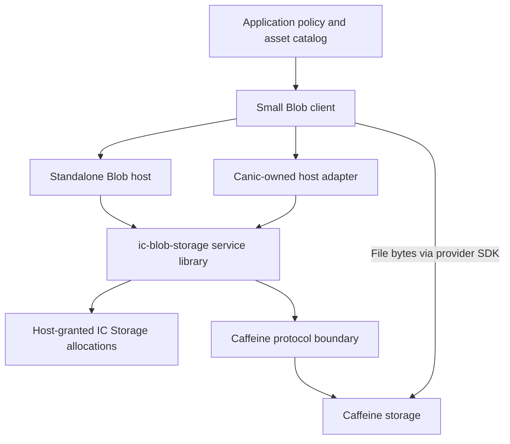

# IC Blob Storage design

Status: accepted product scope and ownership; experimental local implementation.
Provider contracts remain proposed; API and persistence are not frozen.
Date: 2026-11-14. Reconciled with the current implementation and qualification.

## 1. Product direction

`ic-blob-storage` lets an Internet Computer application authorize large-file
uploads to Caffeine, keep track of the files it uses, and understand outstanding
storage obligations. File bytes travel directly between clients and Caffeine.
Blob keeps the small amount of durable control state needed to manage them.

The maintainer has confirmed two requirements: **Caffeine first**, and **usable
both independently and with Canic**. The rewrite exists because the predecessor
grew beyond an understandable product scope. Its reported roughly 100,000 lines
are motivation, not a measured baseline or a feature-parity target.

The accepted direction is one service library with explicit hosting boundaries, one
working upload/read/reference journey, and incremental qualification. Standalone
use must be a first-class maintained path. Canic adds deployment and composition;
it must not supply missing Blob business logic.

Sections 1–4 retain the accepted product scope and ownership. Sections 5–8 specify
the selected rules, subject to D0 provider feasibility. The explicit experimental
profiles and §12 distinguish current behavior from those intended guarantees.
This document does not adopt old APIs, formats, deployments or recovery obligations.

## 2. First useful journey

Start with one application, one Caffeine namespace/account binding, and at least
two authenticated uploaders. Propose public application assets for the first
example: an image or model uploaded by an authorized user. Here, **publication
means publication in the application's catalog**, not making provider bytes
accessible for the first time. Caffeine's [delivery documentation](https://help.caffeine.ai/hc/en-us/articles/46899784111380-File-Storage-Troubleshooting)
describes access by possession of the complete URL. Delaying catalog publication
does not provide confidentiality. Private serving remains outside this release.

1. The developer builds and installs a small standalone Blob canister without
   Canic. Configuration names the application authority, provider binding and
   finite resource limits. Provider account setup is explicit.
2. The application authorizes a particular uploader to store a particular file,
   within an expiry and quota. The service reserves capacity before granting
   externally usable upload authority.
3. The client obtains that authority and uploads directly through the selected
   Caffeine SDK. Interrupted work retains its original upload identity.
4. The client reads the file back and verifies content identity and length against
   its trusted original declaration. The application decides whether to publish
   its asset record.
5. A second asset can hold a distinct reference to the same registered object
   within that application. Releasing the first reference preserves the second.
6. The application releases the final reference. Inspection distinguishes local
   release from provider deletion and billing settlement.
7. A qualified ordinary upgrade preserves references, reservations and unresolved
   effects. Lost replies can be inspected without creating a fresh operation.

Then run the same application journey in a Canic-managed host using the same
library. A dedicated standalone service deployed by Canic is also useful; it
does not require embedding Blob into every application canister. Qualify each
arrangement actually offered rather than assuming one proves the other.

The first delivery includes runnable instructions and a small client example.
Use one representative multi-chunk file as well as a small file. No fixed size,
throughput, price or confidentiality promise is chosen before measurement and
provider review.

### D0 first gate: supported independent Caffeine access

The selected candidate is an independently installed Rust host using Caffeine
storage. DFINITY now supplies a reviewed public Rust deployment, funding and
account-linking recipe; anonymous mainnet reads confirm the advertised Cashier
interface and successful gateway/price queries. See the
[independent qualification review](caffeine-contract-review.md#independent-qualification--2026-11-15)
for pinned source, observations and limits. This supersedes the earlier absence
of an enrollment recipe. The separate payer/owner path is the next bootstrap
candidate; no automatic funding subsystem is added to Blob.

The [fresh payer funding witness](caffeine-contract-review.md#fresh-payer-funding-witness--2026-11-15)
now establishes one acknowledged deposit/credit path. **Fresh owner enrollment
and the full provider contract remain unqualified.** The
maintainer directs independent research and experiments without Caffeine outreach;
provider correspondence is not a prerequisite. Complete this table with sourced
contract evidence, bounded observations and explicit remaining limitations before
freezing identities, APIs or persistence. A passing sample cannot establish a
universal guarantee; unknown enforcement stays declared-only accounting and
unknown closure stays unresolved exposure. No generic provider abstraction or
speculative certificate format is a substitute.

| Contract question | Required answer/evidence | Current disposition |
| --- | --- | --- |
| Independent access | Published independent Rust integration and qualified fresh enrollment | Published recipe and acknowledged fresh payer funding; owner binding, allocation and gateway admission still to qualify |
| Account and namespace | Actual payer, namespace binding and exclusive retention/deletion scope | Require one immutable binding and exclusive scope; provider support unqualified |
| Upload authority | Exact enforced fields, caller/bearer semantics, validity and in-progress transfer rules | Reviewed path uses an IC-certified method/root reply; provider enforcement remains unqualified |
| Lost authority reply | Recovery of the original usable proof, or explicit blocked outcome | Legacy retains original IC request identity; recovered-proof acceptance and SDK resume remain unqualified; no second issuance fallback |
| Object identity and callbacks | Deletion scope/key, incarnation support, authenticated message source and exact meaning | Unqualified; unknown objects cannot grant deletion |
| Authority lifetime | How old or delayed authority becomes incapable of recreating storage/charges | Unqualified; no arbitrary grace period |
| Closure | Evidence of deletion and separate final charge cutoff, including late effects | Unqualified; retain unresolved Closing objects |
| Charging and limits | Upload, storage and download charges; behavior after balance exhaustion; enforceable caps, if any | Account-specific evidence required; prefunding is not a liability cap |

The feasibility witness must join independent host enrollment, account/namespace
binding, usable upload authority, direct SDK transfer and the retention protocol.
Read-only contract/source review comes first. The maintainer has authorized
Caffeine calls when the implementation is ready and use of the local
`canic-mainnet` wallet for needed cycles; carry that authorization forward.
A live witness still needs an identified fresh installation/account, explicit
resource bounds and durable custody of all possible effects. If independent access is unsupported,
stop this delivery path and return the product choice to the maintainer.

D0 selects evidence-backed rules and their limits, without requiring a live test
of an unimplemented host. D1 qualifies installed local rules with labelled
substitutes; bounded D2 experiments can refine the selected contract, while
missing guarantees remain open. The
[field enforcement matrix and qualification sequence](caffeine-contract-review.md#field-enforcement-required-before-registration)
specify the next witnesses and stopping points. The legacy November deletion
follow-up still did not establish closure. The maintainer initially approved
an experimental heap-only model, then expanded that scope to a locally installed
standalone host and Caffeine calls when ready. Local caller and upgrade testing
may therefore proceed with provider effects disabled while D0 remains open.
This is experimental qualification, not D0/D1 completion or a frozen API/persistence
format. Real upload authority still requires durable control state and the
applicable provider contract; the existing heap-only model cannot supply it.
Provider-call authorization does not authorize issue comments, email or other
outreach, or importing the predecessor's accounts and outstanding obligations.

## 3. Scope and exclusions

| Responsibility | Initial disposition |
| --- | --- |
| Upload authorization and bounded admission | Essential Blob behavior |
| Durable upload identity, registration and references | Essential Blob behavior |
| Caffeine upload authority and required callbacks | One concrete integration, qualified against the selected provider contract |
| Direct upload and verified read | One owned minimal transfer client; application owns publication after verified read |
| Logical usage and outstanding provider exposure | Essential, with explicitly different meanings |
| Inspection, lost replies and ordinary upgrades | Part of the useful journey, not a later reliability rewrite |
| Canic hosting | Thin consumer-owned composition over the same library |
| Private serving, encryption and revocable download access | Deferred pending a named consumer and provider capability |
| Automatic funding, tenant balances, invoicing and refunds | Deferred; begin with explicit operator-provisioned funding |
| Multiple providers or storing file bodies in canisters | Out of the initial product |
| Cross-tenant deduplication, global content catalog and sharding | Deferred; no speculative abstraction |
| Bulk publication CLI, browser automation and worker bridge | Deferred until the small client journey demonstrates a need |
| Arbitrary backup rollback and cross-schema migration framework | Out of the first supported recovery contract |
| Legacy compatibility, live probes and retirement work | Separate legacy-owned scope; never imported into this checkout |

Deferring funding automation does not make storage free. The first service must
know which provider account can incur charges and expose unresolved obligations.
If that provider arrangement cannot operate without a Blob-owned paid call, admit
that single funding operation explicitly before the first live journey; do not
hide it in installation or introduce a general payments subsystem.

## 4. Architecture and ownership



The two hosts are alternative placements of the same state owner, not replicas
of one installation. An application embedding Blob calls the library locally;
a remote caller uses the hosted protocol. Nothing should require a remote call
back into the same canister to reuse a workflow.

An embedded application may compose synchronous reference changes and local
catalog changes within one IC message where both stores support its rollback
semantics. Remote catalog calls and provider effects remain separate transactions.

The [application/host boundary](application-boundary.md) makes the public asset
catalog the first reference consumer. It specifies direct uploader versus
application calls, cancellation while authorization/publication is unresolved,
and catalog removal before remote release. It also identifies the root-only
certificate request's historical grant ambiguity. These are integration rules;
the offline example does not qualify their remote execution.

| Owner | Owns | Does not own |
| --- | --- | --- |
| Application | User identity mapping, permission to create assets, catalog transactions, publication and reference-release coordination | Provider protocol or a second Blob ledger |
| Blob library | Upload policy, reservations, registration, references, usage, provider-operation meaning and durable recovery state | Endpoint exports, framework lifecycle, deployment or application login |
| Standalone host | Actual caller capture, endpoint mounting, transport bounds, initialization and lifecycle composition | Alternate service rules |
| Canic adapter, in Canic | The same host duties within its runtime, memory grants and deployment/funding bindings | A copied Blob engine or implicit user authority |
| Caffeine boundary | Translation of the selected provider contract and authenticated result/callback handling | Invented provider guarantees |
| Client | Local file preparation, serial provider transfer, retained request identity and read verification | Authority to declare provider settlement or mutate the application's catalog |

Use IC Storage checked allocations through one host-owned runtime. Blob declares
its needs and accepts admitted grants; it neither assigns raw memory IDs nor
creates another memory manager. The host owns wakeups if a demonstrated workflow
needs them; Blob owns the durable work being resumed.

### Selected crate layout

The maintainer accepted this layout on 2026-11-14. The library, experimental host
and installed test package now exist. The maintainer approved the minimal owned
browser transfer client on 2026-11-15; its first local implementation exists.
The separate qualification workspace was accepted on 2026-11-15.

```text
crates/
  ic-blob-storage/           # Reusable service library; exists today
  ic-blob-storage-canister/  # Experimental standalone Wire host
  ic-blob-storage-cli/       # Native storage inspection, enrollment proposals and maintenance
  ic-blob-storage-reference-app/ # Standalone durable application catalog
clients/
  browser/                  # Minimal owned client; no automatic transfer replay
qualification/
  Cargo.toml                # Independent unpublished qualification workspace
  Cargo.lock                # Qualification dependency graph
  ic-blob-storage-tests/     # Real host Wasm exercised in PocketIC
  ic-blob-storage-reply-probe/ # Installed codec-failure rollback fixture
```

The four production crates share the root Cargo workspace and lockfile. The
standalone host depends on the library, captures callers, mounts endpoints,
supplies memory grants and composes lifecycle hooks. It owns no alternate ledger
or business rules. The library exports no canister endpoints merely by linking it.
Canic owns its adapter in the Canic repository and depends on this same library;
it does not depend on the standalone executable.
The [Canic adapter handoff](application-boundary.md#canic-adapter-handoff) maps the
current Service API to a first embedded catalog witness, including trusted local
authority, one Storage bootstrap and atomic catalog/reference failures. Its
[composed witness review](application-boundary.md#composed-witness-reviewed--2026-11-15)
records Canic's implemented adapter and installed local evidence, separately from
the still-open fleet management and provider journey.

The [reference application](reference-application.md) owns its bounded drafts,
publication decisions and cleanup intent in a separate canister. It calls the
standalone host's existing methods; it adds no Blob ledger or generic adapter.

Initially organize the library by upload, objects/references, persistence and the
concrete Caffeine boundary, introducing modules as behavior arrives. Keep one
production state implementation. These responsibilities do not require a trait
or crate per noun. Directory modules keep their tests beside `mod.rs`; the current
reference owner and its tests remain one module with the same public Rust path.

`qualification/` is for installed-service tests, not ordinary domain tests. Its
packages are unpublished test-role members of their own workspace, using
the real standalone Wasm artifact and PocketIC. It exercises captured IC callers,
endpoints and upgrades. PocketIC supplies caller identities; this is not a live
signed-ingress or provider-certificate witness.
It must not contain a second Blob engine or a test-only canister standing in for
the production host. Local substitutes cannot establish Caffeine guarantees.

Keep native domain tests with their library owner. Canic composition tests stay
in Canic; browser transfer tests stay with the client. `make test-standalone` owns
the focused installed check. The qualification manifest and lockfile isolate its
simulator dependencies from the product workspace, following the installed Toko
layout. Packages retain explicit private versions independently of product releases.
Both workspaces select the same tooling payload and inherit the common lint policy.
There is no empty package or generic harness.

Extract a runtime-free contracts package only when the remote client needs shared
types without service storage dependencies. The native admin binary serves
guarded maintenance and [storage inspection](../operations/storage-inspection.md):
one application's uploader inventory, a separate provider-reported account view,
and an offline enrollment proposal. The library derives uploader inventory from
existing grants and references; application authority remains required and shared
roots count once per view. This adds no persistent index or provider effect.
The CLI consumes the same protocol types and Platform Agent; the service library
does not depend on it. Do not pre-create the predecessor's five-package
layout or its independent release groups.

Canic stays out of the library's dependencies, ordinary tests and standalone
development path. Canic owns its composed qualification. Blob's independent
checks must remain usable when a downstream adapter has an incompatible graph.
Platform owns external IC runtime/protocol adapters; Wire owns codecs for our
RPC. Required provider encodings stay at the external boundary. SDK/protocol
semantics are D0 design inputs. Exact versions are implementation choices only
within that understood contract and after compatibility qualification; they are
not inherited from the legacy lockfile.

## 5. Small domain model

### Identities and one object owner

Every actual provider object must resolve to **one local owner of all references
and deletion decisions**. Upload attempts are not independent deletion owners.
Initial installations require exclusive retention authority over their provider
deletion scope. Another installation must not write into that scope. A provider
lease isolating retention could support another model later; it is not assumed.

| Identity | Immutable meaning and ownership |
| --- | --- |
| Installation binding | Actual service, configured application authority, provider/account/namespace and exclusive deletion scope; fixed for the installation |
| Provider object key | Qualified provider binding + deletion key/root + provider incarnation when supported; resolves to exactly one local object owner |
| Upload ID | One application-authorized declaration, uploader, deadline and first reference ID; points to the object owner, never a separate deletion right |
| Reference ID | Application-scoped name bound permanently to one object; application supplies it, including the first reference in upload authorization |
| Operation identity | Exact scoped mutation and arguments; replay cannot change its target or recreate a released reference |

Resolve the provider key and compare declarations before accepting a new upload
identity. A matching authorized use attaches a distinct reference to the same Open
owner and counts no second stored copy. This is application-authorized reference
acquisition, not permission for another provider upload. Before first registration,
the original bound uploader may consume its still-eligible grant; concurrent grants
for the same reserved key are refused. After registration, missing authority requires
qualified recovery of the original IC result, or remains blocked. Another upload ID
cannot obtain fresh issuance. Conflicting declarations reject.
Closing or Settled keys cannot be admitted as new objects in the initial release.
The maintainer selected one upload lifetime per root on 2026-11-14, including
cancelled/expired grants that never registered. Keep the original root claim for
the installation lifetime; a new upload ID, uploader or deadline cannot restart
it. This deliberately prevents retrying cancelled content under the same root.
Additional references to an existing Open owner remain supported. Do not work
around retirement by manufacturing different metadata or resetting the ledger.
If the provider lacks incarnations, do not invent a local generation that its
callbacks cannot distinguish. Record layout may combine records; ownership may not.

The binding cannot be changed to reinterpret existing obligations. A new binding
requires a separate installation/scope and an explicit disposition of the old
one. Dynamic tenant enrollment and cross-tenant sharing remain out of scope.
Reference IDs have one lifetime: reserved for a grant, live on registration or
retain, then released (or retired unused on cancellation). They are never recycled.
Releasing a reserved first reference atomically cancels its unconsumed grant and
frees its byte reservation. If consumption already committed, the same request
performs the normal live-reference release instead; the two transitions serialize.
Unexposed retirement preserves the root claim without adding provider exposure;
it is not a deletion acknowledgment or settlement outcome.

### Permission table

| Operation | Authorized actor | Effect |
| --- | --- | --- |
| Authorize upload | Configured application authority | Bind exact declaration, uploader, first reference ID and deadline; reserve resources |
| Obtain upload authority | Uploader bound to that grant | Consume eligible grant; register before any usable authority can escape |
| Inspect upload | Bound uploader or application authority | Read that upload's state/outcome; no credential reissue implicit in inspection |
| Retain/release reference | Application authority | Manage application-owned uses, not uploader-owned lifetimes |
| Inspect reference | Application authority | Read exact target, historical result and current liveness |
| Inspect known object | Application authority | Read original grant, local retention and live-use count; no provider availability or deletion permission |
| Inspect application-wide usage/obligations | Application authority or explicitly permitted operator | Bounded inspection; no grant or reference mutation |
| Process provider message | Authenticated actor/proof required by selected protocol | Record its exact meaning for a matched original obligation |

Knowledge of any ID/root grants nothing. Controller status and Canic membership
grant no application role. Anonymous callers are not authenticated uploaders.
Only the bound uploader may acquire authority from Blob; whether another holder
can use the resulting proof depends on the provider's bearer/identity contract.

Public endpoints capture actual ingress identity. Embedded code enters through
an explicitly trusted application-policy boundary after its own checks. Neither
path accepts an ordinary DTO field claiming to be an authorized actor. This is
an internal API boundary, not a second identity framework. The application can
always name and release the predetermined first reference if the client disappears.

### Declaration and effect bounds

The accepted root, length, manifest and provider-enforced limits must describe
the same permitted object. The provider contract must fill in the enforcement
column below before the service claims a bound on actual storage exposure.

| Declaration field | Blob validation | Provider fact to qualify |
| --- | --- | --- |
| Binding and object key | Match immutable installation and unique owner | Upload and deletion use the same account/namespace/object identity |
| Root and manifest | Bounded structure, chunk ordering and authenticated root construction under selected algorithm | Which content commitments are actually enforced |
| Length and chunk sizes | Checked totals and root/length relationship, including partial final chunk | Cannot accept more bytes/copies than the admitted bound; tree consistency alone is insufficient |
| Uploader, deadline and first reference | Actor/grant checks and immutable reference target | Identity-bound versus bearer use, expiration and ongoing-transfer behavior |

Reject inconsistent declarations before exposure. A malicious uploader can skip
the example client, so optional download verification is not admission enforcement.
If the provider cannot enforce the required bound, D0 must explicitly choose
weaker **declared usage** semantics or block that profile; it cannot label those
values conservative physical exposure. SDK transfer progress stays client-owned;
Blob persists only bounded control information required by this contract.

## 6. Registration, availability and deletion

Use precise statements instead of one ambiguous `Complete` or `Verified` flag:

| Fact | What it proves |
| --- | --- |
| Reserved | Local capacity was set aside for an exact upload |
| Registered | Upload authority may have escaped; retention intent and a first reference were committed |
| Client verified a read | Those observed bytes matched the expected declaration at that time |
| Referenced | At least one local application use remains |
| Final reference released | The application no longer requests retention through this installation |
| Provider deletion acknowledged | Only the meaning established by the actual provider callback contract |
| Billing settled | Only the independently established charge cutoff/settlement meaning |

Registration and references belong to durable Blob state. Client verification is
an observation, not a server-side proof of permanent availability. There is no
independent verifier service, attestation worker or public "mark uploaded" setter
in the proposed initial design. The application may require verified reads before
publishing and must handle a later unavailable object.

For the reviewed Caffeine path, registration and the method/root reply are one
synchronous host execution. Grant consumption, object binding, first-reference
creation, reservation transfer and possible exposure commit before that reply can
become usable IC-certified authority. There is no provider acquisition request or
completion callback in this transition. Expiry frees only a provably unexposed
reservation; later revocation cannot retract a committed reply or erase exposure.

Distinct references protect overlapping application uses. Acquire the new
reference before publishing a second asset; release the old one only when its
application use has ended. The application retains exact requests across its
catalog transaction and Blob calls. A failed catalog commit can leave a reference
to release; a lost response must not cause the application to invent a new upload.
There is no atomic transaction spanning a remote catalog, Blob and Caffeine;
the local embedded case is described in §4.

### Object transitions and closure

| State | Meaning | Allowed next step |
| --- | --- | --- |
| Open | At least one live application reference; no availability assertion | Authorized additional references, or release; last release atomically enters Closing |
| Closing | No live references; irreversible refusal of new references and new upload-authority exposure | Record original outcomes and resolve outstanding obligations; never reopen |
| Settled | Selected provider contract proves closure, including authority lifetime, deletion and charge cutoff | Inspection and historical replay only; retain callback/replay protection |

A reserved, unexposed grant precedes these object states. Release and synchronous
issuance have two possible orders:

| First committed transition | Later transition and retained obligation |
| --- | --- |
| Release cancels the reserved first reference | The root remains retired; delayed issuance refuses; no provider exposure was created |
| Issuance registers the object and commits its reply | Final release enters Closing and retains exposure, even if the uploader has not received the IC-certified result |

No later grant can replace that root's original lifetime. A grant cannot cancel
or expire away an Open/Closing object's exposure. Refusing another issuance call
does not stop delivery or independent recovery of an already committed IC result.
The original ingress expiry also does not expire that historical result's derived
authority: a later IC read-state certificate can attest the same reply after that
deadline. Keep [grant, ingress, certificate and provider lifetimes distinct](caffeine-contract-review.md#authority-lifetime-separate-clocks--development-01009).

Closing retains every issued, possibly issued or unresolved upload authority.
Before settlement, prove that authority cannot recreate bytes or charges: for
example, qualified revocation, or expiry plus an established bound on in-progress
transfers. A deletion acknowledgment alone is insufficient. Late delivery of the
original certified reply is covered by exposure already recorded at registration;
it causes no new local transition and must not reopen the object. A cooperating
client stops forwarding authority after learning of Closing, but that is not a
provider guarantee. If authority can remain usable, keep Closing with its unresolved
reason and exposure capacity occupied. An arbitrary grace period proves nothing.

| Provider message/fact | Local meaning |
| --- | --- |
| Request for permission to delete | Evaluate matched Closing owner and authority-lifetime rules; response is only permission, not a deletion receipt |
| Permission response sent | Does not prove provider receipt or action |
| Authenticated deletion acknowledgment | Record exactly the provider-defined deletion fact; no implied charge cutoff |
| Authenticated final charge/closure evidence | Settle only when all outstanding authority and effects are also closed |
| Unknown, mismatched or stale object message | Return the protocol's qualified refusal/unknown response; missing state never grants deletion |

Duplicate or delayed messages cannot affect another owner or move Closing/Settled
back to Open. If the protocol cannot express safe refusal or cannot isolate the
deletion scope, that is a D0 incompatibility, not permission to guess a response.

## 7. Bounded state and uncertain operations

### Message boundaries and resumption

Entry authorization and validation precede mutations/effects. Precompute each
local transition, then commit it synchronously with no external await. An ordinary
Rust error after a partial mutation is not rollback. Propagate stable-write traps
for IC message rollback; native tests must not assume transactional memory.
IC atomicity covers a message execution, not the request plus its later callback.
A callback trap cannot undo the earlier commit. See [message execution](https://docs.internetcomputer.org/references/message-execution-properties/).

Before an external mutation, retain exact intent, reserved outcome capacity and
possible dispatch. Distinguish proven not sent, known result and uncertain.
Timeout, malformed reply, absent lookup or a fresh request ID cannot make an
uncertain effect safe to repeat. Enforce the restriction at its object/obligation
owner, not just at its request ID. Only qualified idempotency or proof of no send
permits another attempt.

On resumption: (1) authenticate and correlate the provider outcome to the original
attempt, (2) persist that fact and remaining obligation, (3) read current grant,
reference, readiness and object state, then (4) decide whether any *new* authority
or effect is allowed. Caller revocation cannot suppress recording a real result.
A Closing object never reopens. Commit the outcome before optional follow-on work
that could trap; if outcome persistence itself fails, the original possible-effect
record still prevents redispatch. Unauthenticated input is not outcome evidence.

Lost-authority recovery must recover the original usable proof or report blocked.
A method/hash descriptor or registered row is not that proof. Keep the original
IC request identity; do not rerun the issuance endpoint or allocate a new upload ID
to manufacture a replacement. An equivalent fresh proof would require a separately
reviewed protocol change, not a retry mode in this design. Cooperating clients
respect revocation and Closing, but cannot retract possession or independent
recovery of the original IC result. Provider authority-lifetime rules must prevent
recreation. Claim resumable upload only for the demonstrated SDK path.

The [reviewed Caffeine path](caffeine-contract-review.md#candidate-protocol-what-actually-crosses-the-boundary)
issues the descriptor in a synchronous host update; the client obtains its IC
certificate and transfers bytes. Registration and possible exposure commit before
that reply, with no host-to-provider certificate acquisition await. Apply the
resumption rules above wherever a real asynchronous boundary exists; do not invent
one to fit a generic provider interface.

### Accounting and admission

For an admitted object bound of B bytes, define R as capacity reserved by unexposed
new-object grants, L as bytes counted once for each Open object, and E as bytes
counted once for each object with possible unresolved provider storage exposure.
The E claim requires §5's enforced bound. It includes possibly absent and released
objects; it is neither measured physical storage nor a bill. Outstanding charge
or authority facts remain separately recorded even when a byte measure is zero.

| Event for one 100 MB object | R | L | E | Record-capacity consequence |
| --- | ---: | ---: | ---: | --- |
| New object authorized | 100 MB | 0 | 0 | Reserve object, grant, first reference and all required outcome/cleanup slots |
| Registered with first reference | 0 | 100 MB | 100 MB | Transfer reservations atomically; record possible authority exposure |
| Second reference acquired, including through another upload ID | 0 | 100 MB | 100 MB | Consume reference/outcome slots; reserve its future release capacity |
| First reference released | 0 | 100 MB | 100 MB | Retain released identity/result using reserved capacity |
| Final reference released → Closing | 0 | 0 | 100 MB | Preserve closure/outcome slots; refuse new authority/references |
| All provider obligations demonstrably closed → Settled | 0 | 0 | 0 | Retain replay/callback protection; no implicit identity reuse |
| Unexposed grant expires instead of registering | 0 | 0 | 0 | Release byte reservation; retain its retired identity/result |

The expiry row is an alternative from the first row, not a step after settlement.
These counters overlap; R + L + E is not total storage. Initial admission enforces
R + L against the logical capacity limit and R + E against the exposure capacity
limit, reserving both future uses before registration. Each successful registration
moves B from R to L/E without expanding either sum. References consume record
capacity without another byte charge. Final release frees L, never E; repeated
upload/release cannot bypass the exposure limit. Also bound object count, grants,
manifest work, reference/receipt history and inspection pages. Reject empty files
initially; small inputs must not evade record limits.

Admission reserves the space for every admitted reference's release result and
each possible external outcome. Exhaustion blocks new discretionary work, not
inspection or already admitted cleanup. Late/duplicate messages must use existing
bounded records rather than create unlimited event history.

Caffeine's [consumer billing guide](https://help.caffeine.ai/hc/en-us/articles/49362898986644-File-Storage-Costs)
describes upload, continuing-storage and download charges, including accrued
storage charges after credits run out. That is not proof of this crate's account
terms. D2 must qualify actual charges, download exposure and cutoff; finite
prefunding or finite E does not establish finite monetary liability.

### Replay and retention

The bounded pilot retains upload outcomes, immutable reference targets/released
states and effect evidence for the installation lifetime, with explicit capacity
limits. Exact replays authenticate and return historical outcomes without applying
the mutation again. Changed arguments reject. Replaying a successful retain after
release cannot resurrect it. Inspect current liveness separately.

Use domain records for those outcomes; add separate intent/result storage only
where external evidence needs it. Do not duplicate every operation in a generic
receipt journal. Before D4, select and qualify compaction that preserves permanent
stale-request refusal (for example retired sequence ranges or enforced request
validity windows plus durable retirement). TTL deletion alone is prohibited.
Until that rule exists, no eviction or sustained-use claim is supported.

## 8. Persistence and lifecycle

### Experimental installed profile in 0.100.2

The authorized local host uses `local::persistence::Service` around the existing
model, with one host-granted `blob.control.v1` Storage lease. One versioned Wire
record contains the installation principal, immutable authorities/limits, current
maintenance attempt, upload outcomes and reference targets/dispositions. Root
indexes, live-reference counts and R/L/E counters are reconstructed, not persisted
as independent authorities. Missing, foreign, unknown-version or inconsistent
records refuse reopening. No restore, import, migration or repair path exists.

This profile admits at most 64 historical uploads and 64 historical references.
Its 64 KiB record bound and bounded Wire traversal apply before publication.
Every successful mutation rewrites the finite record before replying. Errors in
domain checks precede mutation; a later encoding/storage failure must trap so IC
rollback covers the complete synchronous message. Native callers discard an owner
after a panic. This deliberately simple whole-record strategy is experimental;
it makes no large-store or sustained-churn performance claim.

The library owns one admission gate and monotonic maintenance attempt. Only the
configured manager can drain or activate. Replaying an old drain does not close a
reactivated attempt; a stale activation cannot reopen a newer drain. New grants,
references and registration refuse while drained, while historical success replay,
inspection, release and expiry remain available under ordinary caller rules.
The host rejects upgrades before draining and requires closed admission on reopen.

The manager-only, zero-argument Wire update `blob_management` projects the bound
installation principal, immutable configuration, record format version and current
maintenance state from this same owner. It performs no stable write and remains
available while drained. It is an update so a management transport can authenticate
the replicated outcome; an ordinary query is not a substitute. Neither a decoded
value nor the format version establishes the installed Wasm's identity or continuity
after restore. The native admin authenticates the outcome and compares the admitted
target/configuration and artifact. Its custody chain separately requires original
management outcomes before activation. Local gateway tests exercise actual signed
ingress and verified replies; they do not qualify the live IC or provider.

Local qualification uses a fresh simulator instance, explicit drain, stop, ordinary
same-schema upgrade, start, inspection and activation. The fixture retains the
controller. Direct host tests cover replacement-argument refusal and pre-upgrade
rollback; native CLI tests cover original-request custody and interrupted dispatch.
The supported command set has no destructive replacement path. This does not
establish snapshot freshness, live deployment or compatibility with arbitrary code.
The product standalone host implements no external awaits, timers, provider
callbacks or certificates; the later qualification host exercises candidate
callbacks and certificate replies locally.
The full trusted-management policy below still gates effect-capable deployment.

The current selection uses Runtime 0.22.5 for caller/time and generic
entrypoint/lifecycle hooks, Wire 0.24.0 for bounded RPC codecs, Storage 0.74.1 for
allocation/Cell mechanics, and Testkit 0.106.0 for authenticated PocketIC 16.1.0
setup and server custody. Earlier witnesses retain their recorded supplier identities.
All were selected from stable non-yanked registry releases; no sibling source or
retired Memory runtime is used. Ordinary RPC admission precedes ingress copying;
Runtime lifecycle hooks copy the IC-bounded ingress before explicit Wire decoding.
The library owns only its record format and semantics. Canic can supply a lease
from its own combined bootstrap without adopting the standalone host.

The [private host codecs](../../crates/ic-blob-storage-canister/src/codec.rs) replace
Wire Endpoint for [issue #1](https://github.com/dragginzgame/ic-blob-storage/issues/1).
Platform remains the sole export/copy/dispatch/reply owner. The guard checks the
byte allowance and fixed Wire header before payload copying; decode/encode failures
trap. Application authorization remains in Service and returns typed `Error::Denied`.
`blob_management` remains a replicated update. Method names/IDs, `RPC_LIMITS`,
caller capture, storage and lifecycle semantics are unchanged; Canic is optional.

The [installed frame test](../../qualification/ic-blob-storage-tests/tests/endpoints.rs)
checks exact response frames, malformed/wrong-method/wrong-direction requests,
exact/excess byte limits and denied callers. It passed against both the saved
pre-migration host and its replacement. A separate installed reply probe forces
bounded encoding to trap after a stable write and checks rollback against a
successful-write control. Production responses are fixed-size; the probe qualifies
the selected hooks without adding a production fault mode or a second Blob engine.
The populated standalone witness also passed with the pre-migration Wasm installed
first and the replacement used for upgrades, retaining identities and accounting.

This carries forward the inspected legacy host's separate fresh/open paths and
lifecycle regressions for retained identities, rejected replacement settings and
closed admission after upgrade (source links in §12). It deliberately excludes
per-owner fences, IC-history recovery and funding/gateway subsystems. The current
consumer needs one small bounded control store and one gate; no legacy code or
recovery state was imported. D0/D1 and live provider guarantees remain open.

### Selected initial policy: trusted management path, no rollback

The native path starts with `blob maintenance inspect` (build with `make blob`).
The operator supplies a target/API URL, Ed25519 manager PEM, independently trusted
network root DER, exact expected Wire `blob_init` payload, reviewed uncompressed
Wasm and expected record format. Platform Agent authenticates module-hash reads
before and after the replicated `blob_management` update. The command compares
the response's identity/configuration/format and reports the current attempt/gate.
It bounds file and HTTP response sizes and the whole network operation's duration;
an error returns no successful observation. HTTPS is required except loopback HTTP.
That inspector adds no trust-root discovery, state-changing retry or fresh install.
Explicit maintenance and activation commands are described below.
TCP-error retries are disabled; upstream HTTP behavior is not an exactly-one-POST
guarantee or a general mutation-recovery policy. No operation journal is necessary for the
read-only service method, even though it runs through an IC update.

These authenticated observations are not atomic across management changes and
cannot prove absence of an intervening same-Wasm upgrade or snapshot restore.
They grant no activation permission. `make test-management` exercises the actual
binary through a local IC HTTP gateway with a separately obtained fixture root;
it verifies signed-ingress/certificate handling locally, not mainnet or Caffeine.
Platform 0.33.3 (Agent 0.49.3), Clap 4.6.7 and URL 2.5.8 are the selected native
suppliers; native crypto/HTTP dependencies do not enter the standalone Wasm graph.

The selected policy is a restricted controller-management path. Supported controllers
are trusted to use it and install only reviewed state-preserving code. The standalone
native maintenance entrypoint is implemented and locally qualified below; fresh
provisioning and the Canic fleet-managed lifecycle remain unimplemented. Canic's
embedded lifecycle has a separate simulator witness, not a fleet custody claim. Management stays
outside the reusable Blob engine, with no Blob-owned continuity/recovery framework.

Any future provisioning path must allow fresh installation only into a proven empty
target with a newly admitted provider scope. For an existing Blob installation the
supported maintenance command set excludes
snapshot load/import, reinstall, uninstall, arbitrary stable-state replacement and
unreviewed controller changes. Missing local history never makes an existing target
fresh. Refusal is before dispatch, even for an allegedly pre-exposure backup; do
not build a rollback exception protocol. Snapshot inspection/export can be separate
read-only work, without a restore command in the supported management path.

An unrestricted controller can bypass these checks or install arbitrary code.
That is outside this guarantee. This policy prevents restore through the supported
path; it does **not** claim an old image forcibly loaded through another tool can
detect itself. If that stronger requirement becomes necessary, select and qualify
a platform continuity design before supporting that controller arrangement.

Snapshots restore executable and memory state; the formal load transition does
not call the ordinary post-upgrade hook. A restored readiness flag or a check only
in that hook cannot establish freshness. A version mismatch is also not a restore
proof: the specification permits arbitrary version increments. See [snapshot
load semantics](https://docs.internetcomputer.org/references/ic-interface-spec/abstract-behavior/)
and [system API](https://docs.internetcomputer.org/references/ic-interface-spec/canister-interface/).

### Supported upgrade procedure

1. Enter durable draining mode: refuse new grants, authority exposure and new
   provider dispatch. Permit inspection, releases and recording original outcomes.
   Revoke timer demand for new effects; callbacks cannot start successor calls.
2. Stop the canister and wait for the platform's stopped state. Drain live runtime
   callbacks; a stop failure blocks the upgrade, never triggers reinstall or a
   forced Wasm replacement. Retained uncertain domain operations may remain.
3. Upgrade with the reviewed same-schema artifact. Do not preserve old Rust futures
   or callback environments across the Wasm replacement. Reopen durable state
   synchronously in a non-effecting mode.
4. Validate installation/format, allocation ownership and bounded durable roots,
   limits and accounting metadata. Validate individual records at access. The
   initial finite pilot may additionally scan its bounded records, but must measure
   reopen cost; no unbounded history scan is part of the contract. Missing/corrupt
   records are refusal, never a new installation or automatic repair.
5. Start in inspection-only mode, review retained obligations and explicitly activate
   through the supported management procedure. Restore uncertainty without retry;
   resumption follows §7. Failed validation or unknown management continuity leaves
   new effects disabled. Do not infer continuity from a restored local ready flag.

### Admission while draining and reopening

Use one library-owned admission gate, composed by either host. Closing it is a
durable synchronous transition before the manager requests stop. The host
authenticates the configured management path; an uploader, application-authority
request or ordinary request field cannot assert that management authorization.
Do not add independent upload, reference, timer and provider readiness flags.
The experimental durable service implements the local rules; provider-resume and
production management rules remain future work.

| Operation while admission is closed | Selected rule |
| --- | --- |
| Inspect existing validated state | Allow under the ordinary caller policy; inspection grants no authority |
| Exact authorization or retain replay already recorded | Return the historical outcome without creating a record, reference or effect |
| New grant, attachment, reference or registration | Refuse, even if capacity is available; do not consume its IDs |
| Release an admitted reference or expire an unexposed grant | Allow local cleanup; preserve permanent identities and unresolved exposure |
| Record a matched authentic result from an already dispatched operation | Preserve its outcome and obligation; do not chain another call or reopen admission |
| Timer, retry, new deletion permission or other provider dispatch | Refuse new external effects; clearing timer demand alone is insufficient |

These permissions apply only while the platform runs the canister and the accessed
state is valid. A stopped canister serves no application calls. If durable roots
cannot be validated on reopen, expose only safe host diagnostics, not cleanup over
untrusted records. Unknown-reference cleanup still cannot declare completion;
if resolving it requires a new authorization, the application keeps cleanup pending
until admission reopens. Closed admission does not revoke an escaped certificate.

Activation must refer to the **current maintenance attempt**, whose identity is
retained across the upgrade and never reused. A later drain invalidates every
earlier activation request, including a delayed retry after a lost reply. One
current attempt and its disposition suffice; do not add an unbounded maintenance
receipt ledger. Exact activation replay for that attempt may report its prior
outcome, but cannot reactivate a later closed attempt. The manager serializes
management work for the target; activation also requires its verified artifact,
installation binding and successful reopen checks. This is protection within the
trusted path, not a proof against controller bypass or snapshot restoration.

### Interrupted management operations

The [standalone maintenance runbook](../operations/standalone-maintenance.md)
maps this contract to the current CLI inputs, command sequence and operator
interruption decisions. It does not qualify live deployment or schema migration.

Drain custody uses `prepare-drain`, `dispatch-drain` and `observe-drain`. Preparation
authenticates the existing installation, requires active admission and the explicitly
supplied next attempt, then signs a two-minute `blob_update(Drain(attempt))` request.
Host FS 0.78.0 creates one private claim directory and durably publishes an immutable
Wire intent and exact signed CBOR packet with owner-only file permissions. The intent
binds URL, network root-key hash, target, manager/configuration, Wasm hash, state
format, attempt and packet hash. Private keys are never retained in the claim.
The parent is operator-controlled with no concurrent namespace replacement. Even
an empty directory remains claimed after interruption; no overwrite, cleanup,
automatic repair or replacement identity is permitted. A publication error may
leave complete files visible and is still a refusal.

Observation validates both bounded files and their correspondence to the supplied
target inputs, derives the original IC request ID from strictly decoded call
content, and authenticates only that request's status. Decoding the packet is not
signature authentication or replay permission. It does not submit a call or mint a
new packet. A matching closed-attempt reply establishes the historical acknowledgment,
not current admission; reject, pending, unknown or pruned outcomes return refusal.
Expiry does not authorize renewal. No permanent outcome-retention guarantee is made:
if the IC has forgotten the reply, this slice remains unresolved.

Neither preparation nor observation dispatches the drain. `dispatch-drain` admits
the trusted checkout through the shared tooling check, requiring the binary's exact
snapshot receipt. It then loads the original packet, rejects expiry, and acquires
a Host FS exclusive lock under the single operator-controlled custody root, scoped
by network root-key hash and target. All supported managers must use this root;
deleting claims, substituting its namespace or using another root is outside the
trusted arrangement. The checkout, Makefile and inherited execution environment
are also trusted; the admission command is not a sandbox.

Under the lock, dispatch rejects any existing per-attempt claim, rechecks the host
and active next attempt, and rechecks expiry. It durably publishes the original
request ID in that attempt's claim before invoking Platform with the saved packet.
Any claim entry, including an empty one, bars another submission: a new record or
request ID cannot evade it. A crash or publication failure may strand an unsent
request. Preserve both directories and observe the original outcome; unknown status
is not proof that no effect occurred. No fresh signature, automatic retry or claim
repair exists. The lock covers inspection through the submission result; it does
not constrain controllers using other tools or promise exactly one HTTP exchange.

Installed qualification runs the actual dispatcher with competing processes and a
held target lock, checks tooling refusals before custody creation, and models a
post-claim/pre-transmission interruption that a replacement request cannot bypass.
A fresh CLI observes the original outcome independently of dispatch stdout. Checks
also cover partial/existing request claims, target/packet mismatch, unchanged stable
bytes before dispatch, and historical observation after a later drain.
Version 0.100.4 extends the same custody owner with stop, without a parallel journal
or transport. `prepare-stop` and `dispatch-stop` require the exact current closed
maintenance attempt, a running platform state, the expected module hash and the
manager among the platform controllers. Stop is addressed to the IC management
canister and routed using the Blob target as effective canister ID. Platform owns
the management DTOs and bounded Candid codec; the Blob host stays Wire-only.
The saved packet's recipient, method and exact target argument distinguish stop
from drain. The existing intent format and drain claim names stay valid; stop gets
a separate per-attempt claim under the same target lock. The attempt is a local
admission rule: the platform stop argument does not enforce Blob attempt identity.

`observe-stop` authenticates the original request status and a replicated platform
status call, including the expected artifact/controller binding. It needs no call
to the stopped Blob host. It reports original acknowledgment, rejection, pending
or unavailable outcome separately from platform running/stopping/stopped; only a
stopped observation succeeds. This does not prove that a missing original request
executed. Nor does it authorize restart: start requires the original stop and
upgrade acknowledgments before dispatch. A rejection or
timeout cannot erase the claim or cause automatic restart. Qualification checks
controller refusal, activation/new-attempt refusal, actual stop, original-outcome
observation and refusal after the guarded start has made the host running again.
`prepare-upgrade`, `dispatch-upgrade` and `observe-upgrade` extend this owner with
one ordinary upgrade. Inputs retain the old artifact and add the reviewed replacement
Wasm and original stop record. Preparation requires that stop's authenticated
acknowledgment, matching attempt, old module/controller binding and current stopped
state. Dispatch repeats those checks under the target lock and additionally matches
the stop request ID to its per-attempt dispatch claim. Unknown stop outcome refuses
even if another request has left the platform stopped.

The existing intent/packet format binds the complete `install_code` argument:
target, exact replacement bytes, ordinary upgrade with omitted flags (run the old
pre-upgrade hook and replace heap), fixed Wire `blob_post_upgrade(())`, and no sender
version assertion. An immutable `predecessor.id` binds the original stop. There is
no override for installation mode, hooks or arguments. The first direct-upload
profile bounds uncompressed replacement Wasm to 1 MiB and signed packets to 2 MiB;
larger/chunked installations are outside this slice. Operator review establishes
state compatibility; a valid Wasm header alone does not qualify arbitrary code.

An irreversible per-attempt upgrade claim precedes transmission. A different
request ID cannot bypass it. Observation authenticates the original request's
successful result and the replacement module/controller binding with platform
stopped. A matching module hash cannot resolve an unknown original result, including
same-Wasm upgrades. Rejection preserves the claim and causes no reinstall, rollback,
restart or fresh request. Installed qualification covers actual same-Wasm upgrade,
independent original-outcome observation, predecessor mismatch, replacement-request
refusal, retained state/closed admission after start, and invalid-Wasm rejection
without fallback.

`prepare-start`, `dispatch-start` and `observe-start` reuse that same owner. The
original stop and upgrade records, old/new artifacts and exact attempt remain
explicit inputs. Preparation and dispatch require authenticated acknowledgment of
both predecessors and current stopped state with the replacement artifact/controller.
The start record links the upgrade's request ID; its bounded predecessor chain is
start → upgrade → stop. Dispatch validates both predecessor claims under the target
lock before publishing its own per-attempt start claim. No generic workflow graph,
new journal or automatic retry is added.

A start acknowledgment is followed by authenticated running-state inspection and
replicated Blob inspection between module-hash reads. The replacement artifact,
installation/configuration, record format, exact maintenance attempt and closed
admission must all match. A failure preserves the actual start exposure; it never
stops again, starts again or activates as compensation. `observe-start` requires
that original acknowledgment and repeats the current-state checks. Running state
cannot establish an unknown original outcome, and an old success cannot approve
an active or newer attempt. These are observations within the trusted serialized
management arrangement, not snapshot-continuity proof or activation permission.
Qualification exercises the actual start, fresh-process recovery, corrupt direct
and transitive predecessor claims, unresolved/rejected upgrade refusal, replacement
start refusal and later activation/drain refusal without changing stable state.

`prepare-activate`, `dispatch-activate` and `observe-activate` extend the same
custody owner with `--start-record`. Preparation and dispatch authenticate the
original start acknowledgment and recheck the replacement host's exact currently
drained attempt. Dispatch verifies all three predecessor claims under the target
lock and durably claims this attempt's activation before sending the original
Wire `Activate(attempt)` request. The service independently checks the actual
manager and exact current attempt at execution; delayed activation of an older
attempt refuses even if native preflight observed it before a newer drain.

Activation observation requires the original reply's matching active attempt,
then authenticated running-state, artifact/configuration/format and current active
attempt checks. Unknown original outcome cannot borrow an active-state observation.
A historical acknowledgment followed by a newer drain is reported as a refusal
to confirm current admission, preserving custody without retry or compensation.
The native path does not renew or resubmit activation, even though the service
supports exact-attempt replay. Forgotten original outcomes remain unresolved.
This initial path activates only after its acknowledged stop/upgrade/start chain;
canceling a drain without upgrading is not implemented. Qualification exercises
actual activation, fresh-process observation, missing predecessor claims, unsent
replacement requests, historical observation after a newer drain and a delayed
activation reaching the host. No domain state or format is added. Do not generalize
these management claims into a provider-obligation ledger or snapshot freshness proof.

The [populated native lifecycle qualification](../../qualification/ic-blob-storage-tests/tests/management/lifecycle.rs)
retains four upload identities across drain, stop, upgrade, start and explicit
activation. Its objects include a reserved grant, an Open object shared by two
uploaders with one released reference, and a Closing object with unresolved
declared exposure. All declarations, reference dispositions, owners and R/L/E
counters are compared after drain, reopen and activation. Cross-uploader inspection
and uploader-owned release remain refused. Historical retain cannot resurrect a
released reference; final release and cancellation reduce live/reserved usage while
unresolved exposure survives. Fresh admission succeeds only after activation.

This fixture appends a labelled [Wasm custom section](https://webassembly.github.io/spec/core/binary/modules.html#custom-section)
to the production artifact, producing a distinct hash while preserving executable
code and the storage schema. The native commands keep the original artifact bound
to predecessor custody and validate the replacement after upgrade/start/activation;
inspection using the old artifact refuses afterward. The same-Wasm regression is
retained separately. Neither case qualifies a schema migration, arbitrary candidate
code or actual provider bytes. No extra production mode, crate or dependency exists.

The management entrypoint must bind the target/network, current and intended Wasm
hashes, exact upgrade arguments and selected upgrade options before dispatch. It
retains enough original request identity to resolve a lost reply. These are
management-operation facts, not a second Blob obligation ledger. Missing evidence
leaves admission closed; a matching module hash alone cannot prove that a particular
same-Wasm upgrade and its hooks ran exactly once.

| Interruption | Required disposition |
| --- | --- |
| Drain reply lost | Inspect/recover the same attempt; do not create a new attempt as an automatic retry |
| Stop times out or its reply is lost | Recover the original acknowledgment and observe authenticated stopped state before proceeding. Do not start the canister to make the stop error disappear |
| Upgrade reply lost | Resolve the original request and exact target/artifact outcome; do not blindly dispatch another install or run hooks again |
| Definitive upgrade rejection | Keep the old instance drained and inspect the failure; no reinstall, snapshot fallback or automatic reactivation |
| Start reply lost | Recover the original acknowledgment, then verify running state, the replacement artifact/configuration/format and the matching attempt's closed admission; running alone cannot acknowledge start |
| Activation reply lost | Observe the original request and current attempt without resubmission; a newer drain must remain closed |

The first profile uses ordinary state-preserving upgrade with heap replacement
and without skipping pre-upgrade hooks. Reject caller overrides, replacement
installation arguments and destructive modes before dispatch. Old callbacks,
Rust futures and heap readiness are not a persistence strategy. Downgrading code
is not an automatic failure fallback: it needs its own reviewed state-compatible
upgrade plan and the same stopped/reopen checks. State rollback remains forbidden.

The IC [management contract](https://docs.internetcomputer.org/references/ic-interface-spec/management-canister/)
specifies that a timed-out stop can leave a canister stopping and later stopped;
starting during that interval aborts pending stop calls. It also defines upgrade
options and atomic rejection of `install_code`. A missing response is not that
definitive rejection. The conservative interruption rules above are this product's
selected policy, not additional guarantees supplied by a module hash or timeout.

The [interface specification](https://docs.internetcomputer.org/references/ic-interface-spec/)
describes stopped canisters as having no outstanding responses. The [management
specification](https://docs.internetcomputer.org/references/ic-interface-spec/management-canister/)
advises stopping before upgrades when new code cannot interpret old callbacks.
Select bounded waits for the initial third-party calls where the provider supports
the required semantics. Unbounded waits can prevent clean stop/upgrade; a required
unbounded call is a D0 lifecycle incompatibility to resolve, not a hidden default.
Unknown bounded-wait outcomes stay uncertain; attached cycles need their own loss
accounting if a paid call is later admitted. See [call safety](https://docs.internetcomputer.org/guides/security/inter-canister-calls/)
and [message execution](https://docs.internetcomputer.org/references/message-execution-properties/).

Version persistence deliberately. Same-schema upgrade evidence does not establish
arbitrary migration. Later changes need an explicit disposition for retained state
and effects. No legacy bytes or obligations are reinterpreted or cleared.

## 9. Delivery and acceptance

| Increment | Deliverable | Evidence required to move on |
| --- | --- | --- |
| D0: provider feasibility and contracts | Supported independent Rust-host arrangement, named consumer, completed provider table, identity/authority and management policy | Establish supported access first; qualify object/namespace scope, declaration enforcement, authority recovery/lifetime, callback meanings and charge terms before API/persistence freeze; select exact management entrypoint before D1 |
| D1: local standalone slice | Library, governed persistence, small host and one client example | Two uploaders with cross-user refusal; multi-chunk upload/read; corruption rejection; overlapping references; quota exhaustion and cleanup; lost replies; actual canister upgrade and rollback refusal using labelled provider substitutes |
| D2: bounded provider pilot | Same client and host against an explicitly selected live provider installation | Authorized finite funding/objects, actual account charge/cutoff terms without assuming a spending cap; usable authority recovery, transfer and verified read; retained disposition for every object, outstanding certificate and unresolved cost |
| D3: Canic composition | Canic-owned adapter and runnable application | Same journey and permissions, one memory/lifecycle owner, preserved application and Blob state on upgrade; independent standalone path still works |
| D4: sustained-use claim | Measured capacity, maintenance and operator procedures | Workload-sized instruction/memory/cycle evidence, history retention, deletion/billing guarantees or explicit unsupported claims, supported upgrades and complete operational disposition |

These are acceptance gates, not authorization for deployment or paid effects.
Local models and substitutes prove local behavior; they cannot close provider
guarantees. A successful provider sample does not establish future retention.
Local evidence covers installed caller rules, bounded domain state, maintenance
custody and reopening. The 0.100.9 qualification issuer now joins original proof
recovery, durable transfer claims, six-chunk upload/read and the real application's
catalog, including corruption and cancellation. The HTTP peer is an owned fixture;
the standalone product still exports no provider issuer. **D1 is not declared
complete:** the selected D0 contract and a qualified production arrangement remain
open. Local recovery and lifecycle evidence cannot establish provider proof
acceptance, retention or charge closure.
Do not add speculative management machinery to stand in for that provider evidence.

Current progress is by accepted capability, not a percentage of code written:

| Gate | Current disposition | Next evidence needed |
| --- | --- | --- |
| D0 | Open; published Rust recipe/current ABI, funded payer and owner-origin refusal witnessed | Supported account arrangement, callback/object scope, enforced bounds, authority recovery/lifetime and charge closure |
| D1 | Local policy, durable host/application, maintenance and owned-client upload/read/catalog composition witnessed | Selected D0 contract and qualified production host/client arrangement; local peers do not establish provider semantics |
| D2 | Payer/owner funding and probe installation retained; one owner call refused, relationship removed, missing-tree GET observed; no positive upload | Storage-owned retained-image transition and qualified host/account admission before any live upload |
| D3 | Partial: Canic-owned adapter and embedded catalog have installed local composition evidence; standalone independence preserved | Immutable supplier adoption, fleet-managed lifecycle custody and integrated provider journey |
| D4 | Not claimed; finite history and small-store limits remain explicit | Representative workload measurements and a qualified retention/compaction and operating policy |

The [standalone capacity measurements](standalone-capacity.md) qualify the existing
64-slot history profile for distinct objects, shared uses and reservations, including
cleanup and ordinary upgrade. They record platform execution-cycle charges and
allocated memory, not raw instruction counts or a sustained-use/D4 claim.

The next provider-facing implementation requires the new D0 evidence above.
Further local scaffolding or repeated searches of unchanged sources cannot supply
it. Provider-call authorization remains in force, while outreach remains declined;
neither changes the missing-contract boundary. Latest delivery and focused results
are recorded in the [handoff](../status/current.md).
The maintainer selected the `0.100` rewrite line, starting with the `0.100.0`
GitHub checkpoint. Product versions inherit from the root workspace; qualification
package versions remain independent, with both lockfiles updated for product changes.
Publication remains separate and disabled until an authorized release; this
selection supplies no migration for legacy installations.

Use owner-local behavioral tests for accounting, authority and state transitions.
Add an installed canister qualification package only when it tests real behavior.
Keep the provider/SDK boundary tests and Canic composition proofs at their owners.
Evaluate applicable legacy regression cases and adapt those that protect the
selected contract; requalify them against this implementation rather than copying
the old suite wholesale. Do not test invented package structure. Each increment
must leave the previously delivered journey usable and documented.

The following are service acceptance requirements. Section 12 identifies the
implemented local witnesses and their limits; this table alone does not claim
that the provider-facing or application-callback scenarios pass.

| Scenario | Required behavior |
| --- | --- |
| Two upload IDs identify the same provider object | One object owner; distinct references; releasing one cannot authorize deletion while the other lives |
| Same provider key, conflicting declarations | Reject before reservation/exposure; preserve original owner |
| Uploader knows another user's IDs | Refuse inspection/authority; neither uploader may mutate application references |
| First-reference release races grant consumption | Serialize cancellation or live-reference release; no later authority exposure from the cancelled grant |
| Final release races synchronous issuance or delivery of its committed reply | Cancellation first refuses issuance; issuance first retains exposure through Closing, even when its certified reply arrives later; no reissuance or reopening |
| Previously issued authority can still upload | Deletion acknowledgment does not settle; retain exposure until the qualified lifetime rule closes it |
| Caller revoked during provider operation | Record authentic original result; withhold newly forbidden authority/effects |
| Successful retain replayed after release | Return historical result without resurrection; current state stays released |
| Capacity exhausted | New admissions reject; inspection, admitted release and bounded outcome recording remain possible |
| Fresh request ID for unresolved object obligation | Reject bypass; retain original intent/outcome |
| Lost certificate reply | Recover the original usable proof under qualified bounds, or explicitly report blocked; registration alone and fresh issuance cannot pass |
| Unknown, stale or duplicate provider callback | Authenticate and correlate; no deletion permission from absence, no new owner or duplicate accounting |
| Old snapshot requested through supported management path | Refuse before load dispatch; this proves path refusal, not detection after a controller bypass |
| Supported upgrade with unresolved domain obligations | Drain runtime callbacks; preserve identities, references, counters, released states and uncertainty; no automatic redispatch |
| New work and late callbacks during drain | Refuse new admissions/effects while preserving authorized cleanup, historical replay and matched outcomes; timers cannot bypass the same gate |
| Stop timeout or lost management reply | Keep admission closed; recover the original attempt and observe platform status before advancing; no blind upgrade replay |
| Activation from attempt M arrives after a later drain N | Refuse M without reopening N, including after upgrade and after a lost activation reply |
| Upgrade hook rejects or reopen validation fails | Retain the appropriate closed instance; no reinstall, empty-state initialization or automatic start/activation fallback |
| Reopen invalid state or unknown management continuity | Remain non-effecting; no empty-state fallback or optimistic activation |
| Malicious root/length/manifest mismatch | Admission refuses under the qualified enforcement model; skipping the SDK does not bypass bounds |
| Multi-chunk download | Verify trusted original declaration; reject corruption, truncation, extra bytes and length mismatch without publishing partial output |

The rollback witness is deliberately scoped to the selected management policy.
An actual forced snapshot load bypasses its trust assumption; advertising automatic
post-restore fencing would require a different, separately qualified design.

## 10. Keeping the rewrite understandable

Before subsystem implementation, inspect the relevant legacy implementation,
regressions and history and evaluate what is worth keeping. Prefer sound
first-party code, algorithms and established failure handling when they fit the
new contract; a fresh rewrite does not require solving everything again. Record
the source revision and a brief keep/adapt/replace/omit decision with its reason
in the owning change or design. Reuse is selective and requalified; legacy
architecture, dependencies and provider/recovery custody are not imported by
association. The standing [legacy research instructions](../../AGENTS.md#learn-from-the-predecessor-before-subsystem-work)
own this workflow.

The main control on size is excluding responsibilities, not setting a line quota.
Every new persistent record, abstraction, background job or package should answer:
which consumer action needs it, what failure it prevents, who owns it, and why the
existing operation cannot do the job more simply. Keep that explanation beside
the owning design or change; do not build a second tracking system.

Use one authority check, transition and accounting owner per operation. Hosts
project results. Do not reproduce provider SDK transfer code, shared codecs,
allocation governance, Canic deployment logic or application asset transactions.
Keep independent validation at actual external, corruption and recovery boundaries.

When a contract changes, replace its old description and retire superseded paths
in the same coherent change. This document should describe the selected design;
it should not accumulate every experiment and version-specific workaround.

After **every successful push**, perform the scoped [architecture check](../../AGENTS.md#architecture-check-after-every-push)
before delivery handoff. Inspect what remains around the changed owners as well
as what was added: duplicate decisions, unused layers, speculative configuration
and superseded paths must not quietly accumulate. Explain justified retention
and material code/dependency growth, and report findings with concrete next
actions. Use existing reports and a short handoff, not new maintenance machinery.
Maintainability is a continuing acceptance criterion; returning to an opaque
100,000-line implementation would defeat the purpose of the rewrite.

## 11. Decisions still needed

| Decision | Recommended starting point | Must be resolved before |
| --- | --- | --- |
| Concrete consumer and asset | One small public-asset application, two authenticated users | D0 closure |
| Independent provider support | Complete §2's provider table for an authorized Rust host; no assumption from generated apps or old trials | First D0 gate, before API/persistence freeze |
| Provider deletion scope | Exclusive scope, immutable binding, one owner per actual object as selected in §5 | D0 identity freeze |
| Client experience | Browser SDK example first; native tooling only for a demonstrated operator need | D1 transfer implementation |
| Funding custody | Operator-provisioned account; establish actual upload/storage/download liability and cutoff, no automatic top-ups | D0 contract, D2 verification and any paid operation |
| Catalog publication | Offline example requires verified reads; select the production application's trusted publication policy and await-safe cleanup | Integrated D1 application |
| Supported file sizes and churn | Values derived from representative assets and measured budgets | D1 configuration, then D4 sizing |
| Authority lifetime and closure | Qualify recovery, no-recreation rule, deletion and charge evidence; retain Closing otherwise | D0 protocol, D2 verification |
| Lifecycle entrypoint | Native maintenance is locally qualified; fresh provisioning, provider-call draining and Canic integration remain open | Effect-capable D1/D2 deployment and D3 composition |
| Sustained history | Retain finite pilot history; choose permanent stale-request refusal before any compaction | D4, before eviction |

These choices can change the proposal. They are not excuses to fill in gaps with
legacy mechanisms or implement a universal backend before choosing a consumer.

The revision selects application-owned references, predetermined first-reference
IDs, irreversible Closing, exclusive immutable provider scope, atomic registration,
outcome recording despite revocation and lifetime pilot replay protection. Those
rules no longer wait on an API designer to invent a policy. Provider-supported
field identities and enforceable bounds still require evidence.

## 12. Current implementation and evidence

This section describes the current experimental implementation. The
[current handoff](../status/current.md) owns delivery status and latest validation;
[the retained review at 4709158](https://github.com/dragginzgame/ic-blob-storage/blob/4709158fb9e0322e2313bd0ef2a7d20f4e97e281/docs/design/ic-blob-storage-design.md#12-evidence-and-review-scope)
preserves the earlier source inventory and incremental implementation history.
Historical passing tests and live trials are not qualification of this rewrite.

### Experimental local service model

The [local owner](../../crates/ic-blob-storage/src/local/mod.rs) composes manifest
admission, grants, the existing reference owner and reserved/live/unresolved
**declared-byte** accounting. The installed Service in §8 persists this same policy
owner; there is no second durable policy engine. The heap model alone must not
back real uploads. Hosts supply captured callers and time, never client-selected
identity fields. One installation has one immutable application authority.

Root plus declared length provisionally identifies a matching use within one
hypothetical fixed provider binding. Conflicting lengths and competing reservations
refuse. Matching use of an Open object attaches another reference, with no new
registration right or additional stored-copy accounting. The provider's actual
object/deletion identity remains a D0 input.

Each admitted root permanently names its original upload. Release of the known
first reference before registration cancels its grant; explicit expiry records a
different historical state. Both free the byte reservation but retire the root.
Neither fresh IDs nor another uploader/deadline can restart it. Final release of
a registered object makes it Closing. No identity eviction or settlement exists.

`register(caller, root, now)` follows that original upload and rechecks uploader,
disposition and deadline in one synchronous transition. Exact authorization replay
returns the original request and current disposition; registration replay refuses.
Inspection never returns a usable provider proof. The Wire host exposes this local
transition. The separate qualification host now mounts the experimental root-only
issuer and callback profile, with CLI request custody/recovery; the production
standalone host still exposes neither provider endpoint.
The [application boundary](application-boundary.md) specifies root ambiguity and
remote publication/cleanup rules.

Application-only reference inspection derives the immutable root and Reserved,
Live, Released or Retired status from existing records, including at capacity.
Object inspection derives the original upload, optional retention and live count.
Absent retention means never registered; a released reference may coexist with an
Open object. Registered history and Closing do not establish availability or
settlement. Neither projection adds a persistent index, flag or mutation authority.

Admission checks R + L and R + E and reserves lifetime record slots. Registration
transfers R into L/E; attachment counts no additional copy; final release removes L
only. Occupied slots derive from the maps. Ordinary domain errors precede mutation;
the durable wrapper's subsequent write/encoding failures trap under §8's rollback
rules. Cleanup updates admitted records without requiring additional receipt slots.

### References, integrity and application example

The [reference owner](../../crates/ic-blob-storage/src/references/mod.rs) keeps
bounded lifetime slots, irreversible Closing and non-resurrecting retain replay.
Unknown release does not mutate state. It is used by the local model and Service,
not a test-only alternative. `make test-references` checks its transitions;
`make test-local` checks composed permissions, accounting and durable reopening.

The [verifier and manifest preflight](caffeine-contract-review.md#implemented-local-read-verification)
use the reviewed SDK 1.1.2 tree/metadata algorithm. Verification requires an original
trusted declaration, bounded appends and successful transport EOF; corruption,
truncation and extra bytes refuse. Manifest consistency does not authenticate length
or establish provider enforcement. The linked implementation/reuse records own the
adapted first-party sources and frozen vectors; `make test-caffeine` checks them.

The [offline asset example](../../crates/ic-blob-storage/examples/local_asset/main.rs)
uses two synthetic users, one multi-chunk fixture and named catalog references.
`make example-local` exercises verified publication, cancellation, corrupt-read
refusal, collision cleanup, replacement while another use survives and final release
with unresolved exposure retained. `make test-example-local` checks EOF failures,
truncation/trailing data, cancellation and exact catalog mutation rules.

Its private catalog stores reference IDs, not another liveness ledger. Publication
checks the exact authorization/reference; exact replay preserves the existing use.
Removal compares the expected reference so a delayed request cannot remove a
replacement. These synchronous heap operations are neither a persistent application
catalog nor an atomic remote transaction. The separate [reference application](reference-application.md)
now qualifies durable catalog decisions and actual callback interleaving. Provider
transfer remains unqualified; [application-boundary.md](application-boundary.md)
owns that integration boundary.

### Selective legacy reuse

Legacy review is read-only at `25bed1352f3d2b9659f0d2583f50fa9af859ea84`.
The table records the retained rules and deliberate replacements. Detailed source
and regression links for the earlier slices remain in the pinned review above;
provider and application companions retain their own source/reuse records.

| Boundary and inspected evidence | Retain or adapt | Replace or omit, and why |
| --- | --- | --- |
| [Lifecycle transitions](https://github.com/dragginzgame/ic-blob-storage-legacy/blob/25bed1352f3d2b9659f0d2583f50fa9af859ea84/crates/ic-blob-storage/src/model/lifecycle/transition/mod.rs) and [tests](https://github.com/dragginzgame/ic-blob-storage-legacy/blob/25bed1352f3d2b9659f0d2583f50fa9af859ea84/crates/ic-blob-storage/src/model/lifecycle/tests.rs) | Occupied released identities, unknown-release refusal, irreversible final release; nonzero 128-bit IDs | One reference owner replaces separate transition/receipt layers; admitted release needs no new receipt slot |
| [Root claims](https://github.com/dragginzgame/ic-blob-storage-legacy/blob/25bed1352f3d2b9659f0d2583f50fa9af859ea84/crates/ic-blob-storage/src/model/lifecycle/roots/mod.rs), admission/clock checks and status boundaries | Original root lifetime, immutable replay, caller/deadline checks, reservation first; historical registration distinct from current liveness | Derive mappings/projections from this model; no tenant/generation indexes, duplicate status ledger or provider claim |
| [Host reopening](https://github.com/dragginzgame/ic-blob-storage-legacy/blob/25bed1352f3d2b9659f0d2583f50fa9af859ea84/crates/ic-blob-storage-canister/src/ops/mod.rs) and [installed lifecycle regressions](https://github.com/dragginzgame/ic-blob-storage-legacy/blob/25bed1352f3d2b9659f0d2583f50fa9af859ea84/qualification/ic-blob-storage-pocketic-tests/tests/standalone_lifecycle/mod.rs) | Validated fresh/open distinction, replacement-config refusal, preserved released obligations and closed admission | One bounded record and trusted management path; no per-owner recovery fences, platform-history engine, automatic resume or fixed cooldown rounds without a fixture need |
| [Signed-update custody](https://github.com/dragginzgame/ic-blob-storage-legacy/blob/25bed1352f3d2b9659f0d2583f50fa9af859ea84/crates/ic-blob-storage-cli/src/native/signed_update/mod.rs) and [claim regressions](https://github.com/dragginzgame/ic-blob-storage-legacy/blob/25bed1352f3d2b9659f0d2583f50fa9af859ea84/crates/ic-blob-storage-cli/src/native/signed_update/tests/mod.rs) | Original bytes, durable claim before dispatch, refusal of partial claims, bounded binding checks, observation without renewal | Host FS and Platform APIs serve five explicit maintenance operations; no generic dispatch/report engine or imported recovery custody |
| [Configuration projection](https://github.com/dragginzgame/ic-blob-storage-legacy/blob/25bed1352f3d2b9659f0d2583f50fa9af859ea84/crates/ic-blob-storage/src/ops/service/installation/configuration/mod.rs) and native inspection/recovery owners | Installed versus proposed state, explicit signer/root, original outcome versus current state, recheck after await | Replicated management inspection plus manager/attempt gate; no sealed continuity proof or snapshot detection claim |
| [API owner](https://github.com/dragginzgame/ic-blob-storage-legacy/blob/25bed1352f3d2b9659f0d2583f50fa9af859ea84/crates/ic-blob-storage-canister/src/api/mod.rs) and operations boundary | Pre-copy bounds, explicit codecs, trapping reply failure, one service owner | Three explicit Platform entrypoints replace catalog/manual reply machinery; no second executor or replacement framework |
| [Provider review](caffeine-contract-review.md) and [application evidence](application-boundary.md#evidence-and-acceptance) | Trusted declaration/metadata, original grant resolution, exact intent matching, liveness distinct from retry permission | No patched transfer SDK, certificate journals, tenant routing or application recovery store without the selected provider/consumer contract |

The verifier/manifest companion identifies adapted source separately. The control,
host, management and example slices retain/requalify invariants without copying
legacy implementation. No legacy state, credential, provider obligation or journal
was imported. The sibling was absent during review; its recovery custody was not
opened or reverified. Read its LEGACY.md before separately authorized recovery.

### Qualification boundaries

| Current witness | Established here | Still outside its claim |
| --- | --- | --- |
| `make test-standalone` | Actual host caller rules, bounded history, drain/reopen and retained state; optional explicit predecessor artifact | Provider protocol, arbitrary schema migration or forced-snapshot detection |
| `make test-endpoints` | Raw frame compatibility, pre-copy rejection, exact/excess limits; separate installed encoding-failure rollback probe | Async provider callbacks or a second production host |
| `make test-signed` | Actual signatures and verified replies, identity separation, original upload inspection after discarding a reply, non-resurrecting cleanup | Application-canister forwarding/callback races, network-fault recovery or usable certificate recovery |
| `make test-application` | Durable application catalog, actual inter-canister identity, cancellation during replicated inspection, interrupted cleanup, bounded history and same-format application upgrade | Provider transfer, certificate recovery, arbitrary migration or snapshot continuity |
| `make test-management` | Actual native custody, original-request observation, stop/upgrade/start/activation and populated state across a different artifact hash | Mainnet, macOS execution, fresh provisioning, arbitrary replacement compatibility or controller bypass |

Canic's [composed witness review](application-boundary.md#composed-witness-reviewed--2026-11-15)
records its adapter, embedded catalog and retained installed evidence. Canic owns
that qualification; this repository does not duplicate its suite or claim fleet
management is complete. Blob owns service semantics. Public provider
and IC references establish only the specifically cited constraints. D0 remains
open; local passing checks cannot turn historical traffic into a supported contract.
