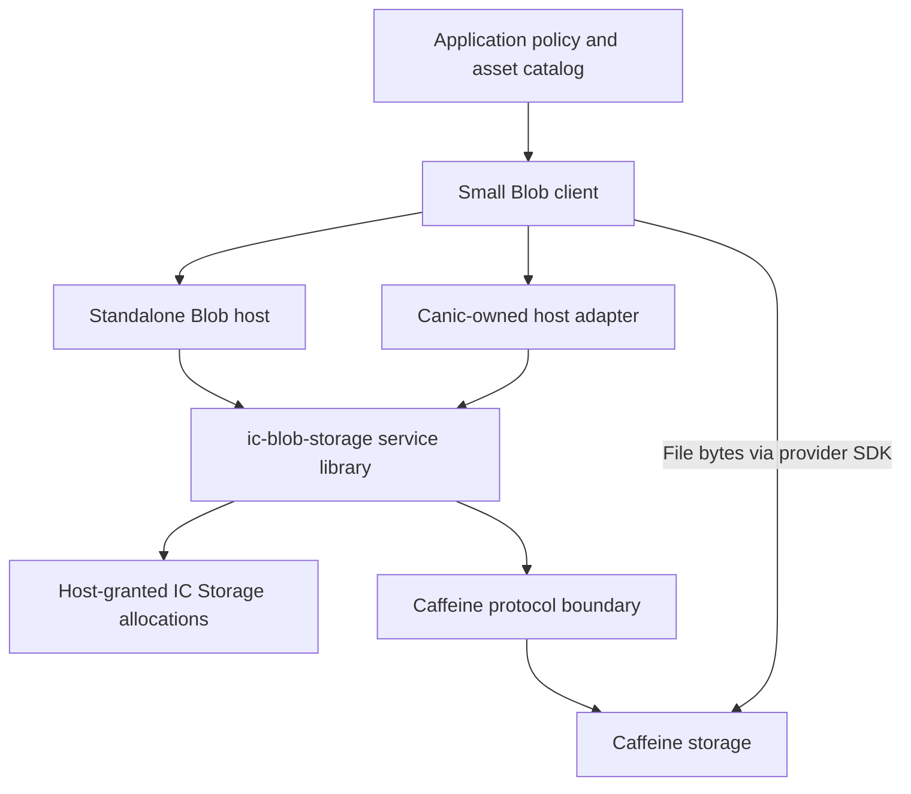

# IC Blob Storage design

Status: product scope and ownership accepted; revision 2 contracts proposed for
review. API and persistence are not frozen; provider feasibility remains open.
Date: 2026-11-14. Revised against the maintainer's design review.

## 1. Product direction

`ic-blob-storage` lets an Internet Computer application authorize large-file
uploads to Caffeine, keep track of the files it uses, and understand outstanding
storage obligations. File bytes travel directly between clients and Caffeine.
Blob keeps the small amount of durable control state needed to manage them.

The maintainer has confirmed two requirements: **Caffeine first**, and **usable
both independently and with Canic**. The rewrite exists because the predecessor
grew beyond an understandable product scope. Its reported roughly 100,000 lines
are motivation, not a measured baseline or a feature-parity target.

The accepted direction is one service library with explicit hosting boundaries, one
working upload/read/reference journey, and incremental qualification. Standalone
use must be a first-class maintained path. Canic adds deployment and composition;
it must not supply missing Blob business logic.

Sections 1–4 retain the accepted product scope and ownership. Sections 5–8 select
precise rules for the next implementation proposal, subject to D0 provider
feasibility; they are not claims of implemented guarantees. This document does
not adopt old APIs, formats, dependencies, deployments or recovery obligations.

## 2. First useful journey

Start with one application, one Caffeine namespace/account binding, and at least
two authenticated uploaders. Propose public application assets for the first
example: an image or model uploaded by an authorized user. Here, **publication
means publication in the application's catalog**, not making provider bytes
accessible for the first time. Caffeine's [delivery documentation](https://help.caffeine.ai/hc/en-us/articles/46899784111380-File-Storage-Troubleshooting)
describes access by possession of the complete URL. Delaying catalog publication
does not provide confidentiality. Private serving remains outside this release.

1. The developer builds and installs a small standalone Blob canister without
   Canic. Configuration names the application authority, provider binding and
   finite resource limits. Provider account setup is explicit.
2. The application authorizes a particular uploader to store a particular file,
   within an expiry and quota. The service reserves capacity before granting
   externally usable upload authority.
3. The client obtains that authority and uploads directly through the selected
   Caffeine SDK. Interrupted work retains its original upload identity.
4. The client reads the file back and verifies content identity and length against
   its trusted original declaration. The application decides whether to publish
   its asset record.
5. A second asset can hold a distinct reference to the same registered object
   within that application. Releasing the first reference preserves the second.
6. The application releases the final reference. Inspection distinguishes local
   release from provider deletion and billing settlement.
7. A qualified ordinary upgrade preserves references, reservations and unresolved
   effects. Lost replies can be inspected without creating a fresh operation.

Then run the same application journey in a Canic-managed host using the same
library. A dedicated standalone service deployed by Canic is also useful; it
does not require embedding Blob into every application canister. Qualify each
arrangement actually offered rather than assuming one proves the other.

The first delivery includes runnable instructions and a small client example.
Use one representative multi-chunk file as well as a small file. No fixed size,
throughput, price or confidentiality promise is chosen before measurement and
provider review.

### D0 first gate: supported independent Caffeine access

The selected candidate is an independently installed Rust host using Caffeine
storage. **That arrangement is not yet qualified or established as supported.**
Caffeine's [GitHub integration guide](https://help.caffeine.ai/hc/en-us/articles/46899843980692-GitHub-Integration-Overview)
says managed storage is unavailable to independently deployed exported apps.
This does not disprove a separately supported lower-level arrangement. The legacy
Blob trials are historical feasibility evidence, not a substitute for its current
contract. The [provider contract review](caffeine-contract-review.md) traces two
reported standalone uploads, the actual SDK/certificate path, relevant legacy
regressions and the precise remaining provider questions. It establishes no new
live qualification or supported enrollment arrangement.

Complete this table with provider-backed answers and an identified protocol/SDK
revision before freezing identities, APIs or persistence. No generic provider
abstraction or speculative certificate format is a substitute.

| Contract question | Required answer/evidence | Current disposition |
| --- | --- | --- |
| Independent access | Supported enrollment/authorization for this Rust host, not merely a Caffeine-generated app | Historical Rust-host transfers reported; current support/enrollment remains unestablished |
| Account and namespace | Actual payer, namespace binding and exclusive retention/deletion scope | Require one immutable binding and exclusive scope; provider support unqualified |
| Upload authority | Exact enforced fields, caller/bearer semantics, validity and in-progress transfer rules | Reviewed path uses an IC-certified method/root reply; provider enforcement remains unqualified |
| Lost authority reply | Recovery of original usable proof, qualified equivalent proof, or explicit blocked outcome | Legacy retains original IC request identity; recovered-proof acceptance and SDK resume remain unqualified |
| Object identity and callbacks | Deletion scope/key, incarnation support, authenticated message source and exact meaning | Unqualified; unknown objects cannot grant deletion |
| Authority lifetime | How old or delayed authority becomes incapable of recreating storage/charges | Unqualified; no arbitrary grace period |
| Closure | Evidence of deletion and separate final charge cutoff, including late effects | Unqualified; retain unresolved Closing objects |
| Charging and limits | Upload, storage and download charges; behavior after balance exhaustion; enforceable caps, if any | Account-specific evidence required; prefunding is not a liability cap |

The feasibility witness must join independent host enrollment, account/namespace
binding, usable upload authority, direct SDK transfer and the retention protocol.
Read-only contract/source review comes first. Any live witness needs separately
authorized effects and retained obligations. If independent access is unsupported,
stop this delivery path and return the product choice to the maintainer.

## 3. Scope and exclusions

| Responsibility | Initial disposition |
| --- | --- |
| Upload authorization and bounded admission | Essential Blob behavior |
| Durable upload identity, registration and references | Essential Blob behavior |
| Caffeine upload authority and required callbacks | One concrete integration, qualified against the selected provider contract |
| Direct upload and verified read | One client path using the provider SDK; application owns publication |
| Logical usage and outstanding provider exposure | Essential, with explicitly different meanings |
| Inspection, lost replies and ordinary upgrades | Part of the useful journey, not a later reliability rewrite |
| Canic hosting | Thin consumer-owned composition over the same library |
| Private serving, encryption and revocable download access | Deferred pending a named consumer and provider capability |
| Automatic funding, tenant balances, invoicing and refunds | Deferred; begin with explicit operator-provisioned funding |
| Multiple providers or storing file bodies in canisters | Out of the initial product |
| Cross-tenant deduplication, global content catalog and sharding | Deferred; no speculative abstraction |
| Bulk publication CLI, browser automation and worker bridge | Deferred until the small client journey demonstrates a need |
| Arbitrary backup rollback and cross-schema migration framework | Out of the first supported recovery contract |
| Legacy compatibility, live probes and retirement work | Separate legacy-owned scope; never imported into this checkout |

Deferring funding automation does not make storage free. The first service must
know which provider account can incur charges and expose unresolved obligations.
If that provider arrangement cannot operate without a Blob-owned paid call, admit
that single funding operation explicitly before the first live journey; do not
hide it in installation or introduce a general payments subsystem.

## 4. Architecture and ownership



The two hosts are alternative placements of the same state owner, not replicas
of one installation. An application embedding Blob calls the library locally;
a remote caller uses the hosted protocol. Nothing should require a remote call
back into the same canister to reuse a workflow.

An embedded application may compose synchronous reference changes and local
catalog changes within one IC message where both stores support its rollback
semantics. Remote catalog calls and provider effects remain separate transactions.

| Owner | Owns | Does not own |
| --- | --- | --- |
| Application | User identity mapping, permission to create assets, catalog transactions, publication and reference-release coordination | Provider protocol or a second Blob ledger |
| Blob library | Upload policy, reservations, registration, references, usage, provider-operation meaning and durable recovery state | Endpoint exports, framework lifecycle, deployment or application login |
| Standalone host | Actual caller capture, endpoint mounting, transport bounds, initialization and lifecycle composition | Alternate service rules |
| Canic adapter, in Canic | The same host duties within its runtime, memory grants and deployment/funding bindings | A copied Blob engine or implicit user authority |
| Caffeine boundary | Translation of the selected provider contract and authenticated result/callback handling | Invented provider guarantees |
| Client | Local file preparation, SDK transfer, retained request identity and read verification | Authority to declare provider settlement or mutate the application's catalog |

Use IC Storage checked allocations through one host-owned runtime. Blob declares
its needs and accepts admitted grants; it neither assigns raw memory IDs nor
creates another memory manager. The host owns wakeups if a demonstrated workflow
needs them; Blob owns the durable work being resumed.

### Selected crate layout

The maintainer accepted this layout on 2026-11-14. Only the library exists now;
create the remaining packages when their callers and behavior exist.

```text
crates/
  ic-blob-storage/           # Reusable service library; exists today
  ic-blob-storage-canister/  # Standalone host; add with real endpoints
clients/
  browser/                  # Client/example using the selected external SDK
qualification/
  crates/
    ic-blob-storage-tests/  # Installed standalone behavior; add with the host
```

The two production crates share the root Cargo workspace and lockfile. The
standalone host depends on the library, captures callers, mounts endpoints,
supplies memory grants and composes lifecycle hooks. It owns no alternate ledger
or business rules. The library exports no canister endpoints merely by linking it.
Canic owns its adapter in the Canic repository and depends on this same library;
it does not depend on the standalone executable.

Initially organize the library by upload, objects/references, persistence and the
concrete Caffeine boundary, introducing modules as behavior arrives. Keep one
production state implementation. These responsibilities do not require a trait
or crate per noun. Directory modules keep their tests beside `mod.rs`; the current
reference owner and its tests remain one module with the same public Rust path.

`qualification/` is for installed-service tests, not ordinary domain tests. Its
first package will be an unpublished test-role member of the root workspace,
using the real standalone Wasm artifact and selected local IC test environment.
Start it when it can install the host, exercise actual signed callers/endpoints
and verify the resulting state; add upgrade checks when persistent state exists.
It must not contain a second Blob engine or a test-only canister standing in for
the production host. Local substitutes cannot establish Caffeine guarantees.

Keep native domain tests with their library owner. Canic composition tests stay
in Canic; browser transfer tests stay with the client. Add focused installed-test
commands with the qualification package. No empty package, second lockfile,
generic harness or qualification command is needed today. A separate resolving
workspace requires an actual integration dependency constraint and its recorded
disposition; directory placement alone does not justify one.

Extract a runtime-free contracts package only when the remote client needs shared
types without service storage dependencies. A separate Rust client package or CLI
also needs an actual caller. Do not pre-create the predecessor's five-package
layout or its independent release groups.

Canic stays out of the library's dependencies, ordinary tests and standalone
development path. Canic owns its composed qualification. Blob's independent
checks must remain usable when a downstream adapter has an incompatible graph.
Platform owns external IC runtime/protocol adapters; Wire owns codecs for our
RPC. Required provider encodings stay at the external boundary. SDK/protocol
semantics are D0 design inputs. Exact versions are implementation choices only
within that understood contract and after compatibility qualification; they are
not inherited from the legacy lockfile.

## 5. Small domain model

### Identities and one object owner

Every actual provider object must resolve to **one local owner of all references
and deletion decisions**. Upload attempts are not independent deletion owners.
Initial installations require exclusive retention authority over their provider
deletion scope. Another installation must not write into that scope. A provider
lease isolating retention could support another model later; it is not assumed.

| Identity | Immutable meaning and ownership |
| --- | --- |
| Installation binding | Actual service, configured application authority, provider/account/namespace and exclusive deletion scope; fixed for the installation |
| Provider object key | Qualified provider binding + deletion key/root + provider incarnation when supported; resolves to exactly one local object owner |
| Upload ID | One application-authorized declaration, uploader, deadline and first reference ID; points to the object owner, never a separate deletion right |
| Reference ID | Application-scoped name bound permanently to one object; application supplies it, including the first reference in upload authorization |
| Operation identity | Exact scoped mutation and arguments; replay cannot change its target or recreate a released reference |

Resolve the provider key and compare declarations before accepting a new upload
identity. A matching authorized use attaches a distinct reference to the same Open
owner and counts no second stored copy. This is application-authorized reference
acquisition, not permission for another provider upload. If transfer authority is
still needed, resume the original object's qualified acquisition/recovery path;
a second upload ID cannot bypass it. Conflicting declarations reject. Before
first registration, concurrent grants for the same reserved key are refused;
the client resumes the existing grant instead of creating competing owners.
Closing or Settled keys cannot be admitted as new objects in the initial release.
If the provider lacks incarnations, do not invent a local generation that its
callbacks cannot distinguish. Record layout may combine records; ownership may not.

The binding cannot be changed to reinterpret existing obligations. A new binding
requires a separate installation/scope and an explicit disposition of the old
one. Dynamic tenant enrollment and cross-tenant sharing remain out of scope.
Reference IDs have one lifetime: reserved for a grant, live on registration or
retain, then released (or retired unused on cancellation). They are never recycled.
Releasing a reserved first reference atomically cancels its unconsumed grant and
frees its byte reservation. If consumption already committed, the same request
performs the normal live-reference release instead; the two transitions serialize.

### Permission table

| Operation | Authorized actor | Effect |
| --- | --- | --- |
| Authorize upload | Configured application authority | Bind exact declaration, uploader, first reference ID and deadline; reserve resources |
| Obtain upload authority | Uploader bound to that grant | Consume eligible grant; register before any usable authority can escape |
| Inspect upload | Bound uploader or application authority | Read that upload's state/outcome; no credential reissue implicit in inspection |
| Retain/release reference | Application authority | Manage application-owned uses, not uploader-owned lifetimes |
| Inspect reference | Application authority | Read exact target, historical result and current liveness |
| Inspect application-wide usage/obligations | Application authority or explicitly permitted operator | Bounded inspection; no grant or reference mutation |
| Process provider message | Authenticated actor/proof required by selected protocol | Record its exact meaning for a matched original obligation |

Knowledge of any ID/root grants nothing. Controller status and Canic membership
grant no application role. Anonymous callers are not authenticated uploaders.
Only the bound uploader may acquire authority from Blob; whether another holder
can use the resulting proof depends on the provider's bearer/identity contract.

Public endpoints capture actual ingress identity. Embedded code enters through
an explicitly trusted application-policy boundary after its own checks. Neither
path accepts an ordinary DTO field claiming to be an authorized actor. This is
an internal API boundary, not a second identity framework. The application can
always name and release the predetermined first reference if the client disappears.

### Declaration and effect bounds

The accepted root, length, manifest and provider-enforced limits must describe
the same permitted object. The provider contract must fill in the enforcement
column below before the service claims a bound on actual storage exposure.

| Declaration field | Blob validation | Provider fact to qualify |
| --- | --- | --- |
| Binding and object key | Match immutable installation and unique owner | Upload and deletion use the same account/namespace/object identity |
| Root and manifest | Bounded structure, chunk ordering and authenticated root construction under selected algorithm | Which content commitments are actually enforced |
| Length and chunk sizes | Checked totals and root/length relationship, including partial final chunk | Cannot accept more bytes/copies than the admitted bound; tree consistency alone is insufficient |
| Uploader, deadline and first reference | Actor/grant checks and immutable reference target | Identity-bound versus bearer use, expiration and ongoing-transfer behavior |

Reject inconsistent declarations before exposure. A malicious uploader can skip
the example client, so optional download verification is not admission enforcement.
If the provider cannot enforce the required bound, D0 must explicitly choose
weaker **declared usage** semantics or block that profile; it cannot label those
values conservative physical exposure. SDK transfer progress stays client-owned;
Blob persists only bounded control information required by this contract.

## 6. Registration, availability and deletion

Use precise statements instead of one ambiguous `Complete` or `Verified` flag:

| Fact | What it proves |
| --- | --- |
| Reserved | Local capacity was set aside for an exact upload |
| Registered | Upload authority may have escaped; retention intent and a first reference were committed |
| Client verified a read | Those observed bytes matched the expected declaration at that time |
| Referenced | At least one local application use remains |
| Final reference released | The application no longer requests retention through this installation |
| Provider deletion acknowledged | Only the meaning established by the actual provider callback contract |
| Billing settled | Only the independently established charge cutoff/settlement meaning |

Registration and references belong to durable Blob state. Client verification is
an observation, not a server-side proof of permanent availability. There is no
independent verifier service, attestation worker or public "mark uploaded" setter
in the proposed initial design. The application may require verified reads before
publishing and must handle a later unavailable object.

Registration commits before exposing usable upload authority, including before
dispatch of any request that could create it. Grant consumption, object binding,
first-reference creation, reservation transfer and possible exposure commit
together. Expiry frees only a provably unexposed reservation. Revocation after
exposure cannot retract a certificate or erase costs.

Distinct references protect overlapping application uses. Acquire the new
reference before publishing a second asset; release the old one only when its
application use has ended. The application retains exact requests across its
catalog transaction and Blob calls. A failed catalog commit can leave a reference
to release; a lost response must not cause the application to invent a new upload.
There is no atomic transaction spanning a remote catalog, Blob and Caffeine;
the local embedded case is described in §4.

### Object transitions and closure

| State | Meaning | Allowed next step |
| --- | --- | --- |
| Open | At least one live application reference; no availability assertion | Authorized additional references, or release; last release atomically enters Closing |
| Closing | No live references; irreversible refusal of new references and new upload-authority exposure | Record original outcomes and resolve outstanding obligations; never reopen |
| Settled | Selected provider contract proves closure, including authority lifetime, deletion and charge cutoff | Inspection and historical replay only; retain callback/replay protection |

A reserved, unexposed grant precedes these object states. A grant cannot cancel
or expire away an Open/Closing object's exposure. Releasing the final reference
also prevents an earlier pending grant from later exposing authority for that key.

Closing retains every issued, possibly issued or unresolved upload authority.
Before settlement, prove that authority cannot recreate bytes or charges: for
example, qualified revocation, or expiry plus an established bound on in-progress
transfers. A deletion acknowledgment alone is insufficient. A delayed acquisition
result is recorded but never reopens the object or authorizes its delivery to the
client. If authority can remain usable, keep Closing with the unresolved reason
and continue charging exposure capacity. An arbitrary grace period proves nothing.

| Provider message/fact | Local meaning |
| --- | --- |
| Request for permission to delete | Evaluate matched Closing owner and authority-lifetime rules; response is only permission, not a deletion receipt |
| Permission response sent | Does not prove provider receipt or action |
| Authenticated deletion acknowledgment | Record exactly the provider-defined deletion fact; no implied charge cutoff |
| Authenticated final charge/closure evidence | Settle only when all outstanding authority and effects are also closed |
| Unknown, mismatched or stale object message | Return the protocol's qualified refusal/unknown response; missing state never grants deletion |

Duplicate or delayed messages cannot affect another owner or move Closing/Settled
back to Open. If the protocol cannot express safe refusal or cannot isolate the
deletion scope, that is a D0 incompatibility, not permission to guess a response.

## 7. Bounded state and uncertain operations

### Message boundaries and resumption

Entry authorization and validation precede mutations/effects. Precompute each
local transition, then commit it synchronously with no external await. An ordinary
Rust error after a partial mutation is not rollback. Propagate stable-write traps
for IC message rollback; native tests must not assume transactional memory.
IC atomicity covers a message execution, not the request plus its later callback.
A callback trap cannot undo the earlier commit. See [message execution](https://docs.internetcomputer.org/references/message-execution-properties/).

Before an external mutation, retain exact intent, reserved outcome capacity and
possible dispatch. Distinguish proven not sent, known result and uncertain.
Timeout, malformed reply, absent lookup or a fresh request ID cannot make an
uncertain effect safe to repeat. Enforce the restriction at its object/obligation
owner, not just at its request ID. Only qualified idempotency or proof of no send
permits another attempt.

On resumption: (1) authenticate and correlate the provider outcome to the original
attempt, (2) persist that fact and remaining obligation, (3) read current grant,
reference, readiness and object state, then (4) decide whether any *new* authority
or effect is allowed. Caller revocation cannot suppress recording a real result.
A Closing object never reopens. Commit the outcome before optional follow-on work
that could trap; if outcome persistence itself fails, the original possible-effect
record still prevents redispatch. Unauthenticated input is not outcome evidence.

Lost-authority recovery must demonstrate one of: recovery of the original usable
proof; an equivalent proof with qualified, bounded effects; or a blocked outcome.
A method/hash descriptor or registered row is not necessarily that proof. Blob
and its cooperating client must respect revocation and Closing; do not hand off
usable authority just because the original request once succeeded. This cannot
prevent possession or independent recovery of an original IC result; the provider's
authority-lifetime rules must prevent recreation. Claim resumable upload only for
the demonstrated SDK path.

The [reviewed Caffeine path](caffeine-contract-review.md#candidate-protocol-what-actually-crosses-the-boundary)
issues the descriptor in a synchronous host update; the client obtains its IC
certificate and transfers bytes. Registration and possible exposure commit before
that reply, with no host-to-provider certificate acquisition await. Apply the
resumption rules above wherever a real asynchronous boundary exists; do not invent
one to fit a generic provider interface.

### Accounting and admission

For an admitted object bound of B bytes, define R as capacity reserved by unexposed
new-object grants, L as bytes counted once for each Open object, and E as bytes
counted once for each object with possible unresolved provider storage exposure.
The E claim requires §5's enforced bound. It includes possibly absent and released
objects; it is neither measured physical storage nor a bill. Outstanding charge
or authority facts remain separately recorded even when a byte measure is zero.

| Event for one 100 MB object | R | L | E | Record-capacity consequence |
| --- | ---: | ---: | ---: | --- |
| New object authorized | 100 MB | 0 | 0 | Reserve object, grant, first reference and all required outcome/cleanup slots |
| Registered with first reference | 0 | 100 MB | 100 MB | Transfer reservations atomically; record possible authority exposure |
| Second reference acquired, including through another upload ID | 0 | 100 MB | 100 MB | Consume reference/outcome slots; reserve its future release capacity |
| First reference released | 0 | 100 MB | 100 MB | Retain released identity/result using reserved capacity |
| Final reference released → Closing | 0 | 0 | 100 MB | Preserve closure/outcome slots; refuse new authority/references |
| All provider obligations demonstrably closed → Settled | 0 | 0 | 0 | Retain replay/callback protection; no implicit identity reuse |
| Unexposed grant expires instead of registering | 0 | 0 | 0 | Release byte reservation; retain its retired identity/result |

The expiry row is an alternative from the first row, not a step after settlement.
These counters overlap; R + L + E is not total storage. Initial admission enforces
R + L against the logical capacity limit and R + E against the exposure capacity
limit, reserving both future uses before registration. Each successful registration
moves B from R to L/E without expanding either sum. References consume record
capacity without another byte charge. Final release frees L, never E; repeated
upload/release cannot bypass the exposure limit. Also bound object count, grants,
manifest work, reference/receipt history and inspection pages. Reject empty files
initially; small inputs must not evade record limits.

Admission reserves the space for every admitted reference's release result and
each possible external outcome. Exhaustion blocks new discretionary work, not
inspection or already admitted cleanup. Late/duplicate messages must use existing
bounded records rather than create unlimited event history.

Caffeine's [consumer billing guide](https://help.caffeine.ai/hc/en-us/articles/49362898986644-File-Storage-Costs)
describes upload, continuing-storage and download charges, including accrued
storage charges after credits run out. That is not proof of this crate's account
terms. D2 must qualify actual charges, download exposure and cutoff; finite
prefunding or finite E does not establish finite monetary liability.

### Replay and retention

The bounded pilot retains upload outcomes, immutable reference targets/released
states and effect evidence for the installation lifetime, with explicit capacity
limits. Exact replays authenticate and return historical outcomes without applying
the mutation again. Changed arguments reject. Replaying a successful retain after
release cannot resurrect it. Inspect current liveness separately.

Use domain records for those outcomes; add separate intent/result storage only
where external evidence needs it. Do not duplicate every operation in a generic
receipt journal. Before D4, select and qualify compaction that preserves permanent
stale-request refusal (for example retired sequence ranges or enforced request
validity windows plus durable retirement). TTL deletion alone is prohibited.
Until that rule exists, no eviction or sustained-use claim is supported.

## 8. Persistence and lifecycle

### Selected initial policy: trusted management path, no rollback

Select a restricted controller-management path, not a Blob-owned continuity or
recovery framework. Supported controllers are trusted to use that path and install
only reviewed state-preserving code. Before D1, identify and qualify the exact
standalone management entrypoint and, for D3, its Canic counterpart. Neither is
implemented by this document. Keep management outside the reusable Blob engine.

The path allows fresh installation only into a proven empty target with a newly
admitted provider scope. For an existing Blob installation it mechanically refuses
snapshot load/import, reinstall, uninstall, arbitrary stable-state replacement and
unreviewed controller changes. Missing local history never makes an existing target
fresh. Refusal is before dispatch, even for an allegedly pre-exposure backup; do
not build a rollback exception protocol. Snapshot inspection/export can be separate
read-only work, without a restore command in the supported management path.

An unrestricted controller can bypass these checks or install arbitrary code.
That is outside this guarantee. This policy prevents restore through the supported
path; it does **not** claim an old image forcibly loaded through another tool can
detect itself. If that stronger requirement becomes necessary, select and qualify
a platform continuity design before supporting that controller arrangement.

Snapshots restore executable and memory state; the formal load transition does
not call the ordinary post-upgrade hook. A restored readiness flag or a check only
in that hook cannot establish freshness. A version mismatch is also not a restore
proof: the specification permits arbitrary version increments. See [snapshot
load semantics](https://docs.internetcomputer.org/references/ic-interface-spec/abstract-behavior/)
and [system API](https://docs.internetcomputer.org/references/ic-interface-spec/canister-interface/).

### Supported upgrade procedure

1. Enter durable draining mode: refuse new grants, authority exposure and new
   provider dispatch. Permit inspection, releases and recording original outcomes.
   Revoke timer demand for new effects; callbacks cannot start successor calls.
2. Stop the canister and wait for the platform's stopped state. Drain live runtime
   callbacks; a stop failure blocks the upgrade, never triggers reinstall or a
   forced Wasm replacement. Retained uncertain domain operations may remain.
3. Upgrade with the reviewed same-schema artifact. Do not preserve old Rust futures
   or callback environments across the Wasm replacement. Reopen durable state
   synchronously in a non-effecting mode.
4. Validate installation/format, allocation ownership and bounded durable roots,
   limits and accounting metadata. Validate individual records at access. The
   initial finite pilot may additionally scan its bounded records, but must measure
   reopen cost; no unbounded history scan is part of the contract. Missing/corrupt
   records are refusal, never a new installation or automatic repair.
5. Start in inspection-only mode, review retained obligations and explicitly activate
   through the supported management procedure. Restore uncertainty without retry;
   resumption follows §7. Failed validation or unknown management continuity leaves
   new effects disabled. Do not infer continuity from a restored local ready flag.

The [interface specification](https://docs.internetcomputer.org/references/ic-interface-spec/)
describes stopped canisters as having no outstanding responses. The [management
specification](https://docs.internetcomputer.org/references/ic-interface-spec/management-canister/)
advises stopping before upgrades when new code cannot interpret old callbacks.
Select bounded waits for the initial third-party calls where the provider supports
the required semantics. Unbounded waits can prevent clean stop/upgrade; a required
unbounded call is a D0 lifecycle incompatibility to resolve, not a hidden default.
Unknown bounded-wait outcomes stay uncertain; attached cycles need their own loss
accounting if a paid call is later admitted. See [call safety](https://docs.internetcomputer.org/guides/security/inter-canister-calls/)
and [message execution](https://docs.internetcomputer.org/references/message-execution-properties/).

Version persistence deliberately. Same-schema upgrade evidence does not establish
arbitrary migration. Later changes need an explicit disposition for retained state
and effects. No legacy bytes or obligations are reinterpreted or cleared.

## 9. Delivery and acceptance

| Increment | Deliverable | Evidence required to move on |
| --- | --- | --- |
| D0: provider feasibility and contracts | Supported independent Rust-host arrangement, named consumer, completed provider table, identity/authority and management policy | Establish supported access first; qualify object/namespace scope, declaration enforcement, authority recovery/lifetime, callback meanings and charge terms before API/persistence freeze; select exact management entrypoint before D1 |
| D1: local standalone slice | Library, governed persistence, small host and one client example | Two uploaders with cross-user refusal; multi-chunk upload/read; corruption rejection; overlapping references; quota exhaustion and cleanup; lost replies; actual canister upgrade and rollback refusal using labelled provider substitutes |
| D2: bounded provider pilot | Same client and host against an explicitly selected live provider installation | Authorized finite funding/objects, actual account charge/cutoff terms without assuming a spending cap; usable authority recovery, transfer and verified read; retained disposition for every object, outstanding certificate and unresolved cost |
| D3: Canic composition | Canic-owned adapter and runnable application | Same journey and permissions, one memory/lifecycle owner, preserved application and Blob state on upgrade; independent standalone path still works |
| D4: sustained-use claim | Measured capacity, maintenance and operator procedures | Workload-sized instruction/memory/cycle evidence, history retention, deletion/billing guarantees or explicit unsupported claims, supported upgrades and complete operational disposition |

These are acceptance gates, not authorization for deployment or paid effects.
Local models and substitutes prove local behavior; they cannot close provider
guarantees. A successful provider sample does not establish future retention.
The maintainer selected `0.100.0` as the rewrite release line, inherited from the
root workspace. Publication remains separate and disabled until an authorized
release; this selection supplies no migration for legacy installations.

Use owner-local behavioral tests for accounting, authority and state transitions.
Add an installed canister qualification package only when it tests real behavior.
Keep the provider/SDK boundary tests and Canic composition proofs at their owners.
Evaluate applicable legacy regression cases and adapt those that protect the
selected contract; requalify them against this implementation rather than copying
the old suite wholesale. Do not test invented package structure. Each increment
must leave the previously delivered journey usable and documented.

The following are service acceptance scenarios. The first local reference slice
below covers only their provider-independent reference behavior; the remaining
scenarios are not placeholder tests or claimed as passing.

| Scenario | Required behavior |
| --- | --- |
| Two upload IDs identify the same provider object | One object owner; distinct references; releasing one cannot authorize deletion while the other lives |
| Same provider key, conflicting declarations | Reject before reservation/exposure; preserve original owner |
| Uploader knows another user's IDs | Refuse inspection/authority; neither uploader may mutate application references |
| First-reference release races grant consumption | Serialize cancellation or live-reference release; no later authority exposure from the cancelled grant |
| Final release races certificate acquisition/delivery | Commit Closing immediately; retain actual exposure/outcome; withhold new usable authority; never reopen |
| Previously issued authority can still upload | Deletion acknowledgment does not settle; retain exposure until the qualified lifetime rule closes it |
| Caller revoked during provider operation | Record authentic original result; withhold newly forbidden authority/effects |
| Successful retain replayed after release | Return historical result without resurrection; current state stays released |
| Capacity exhausted | New admissions reject; inspection, admitted release and bounded outcome recording remain possible |
| Fresh request ID for unresolved object obligation | Reject bypass; retain original intent/outcome |
| Lost certificate reply | Recover usable original/equivalent proof under qualified bounds, or explicitly report blocked; registration alone cannot pass |
| Unknown, stale or duplicate provider callback | Authenticate and correlate; no deletion permission from absence, no new owner or duplicate accounting |
| Old snapshot requested through supported management path | Refuse before load dispatch; this proves path refusal, not detection after a controller bypass |
| Supported upgrade with unresolved domain obligations | Drain runtime callbacks; preserve identities, references, counters, released states and uncertainty; no automatic redispatch |
| Reopen invalid state or unknown management continuity | Remain non-effecting; no empty-state fallback or optimistic activation |
| Malicious root/length/manifest mismatch | Admission refuses under the qualified enforcement model; skipping the SDK does not bypass bounds |
| Multi-chunk download | Verify trusted original declaration; reject corruption, truncation, extra bytes and length mismatch without publishing partial output |

The rollback witness is deliberately scoped to the selected management policy.
An actual forced snapshot load bypasses its trust assumption; advertising automatic
post-restore fencing would require a different, separately qualified design.

## 10. Keeping the rewrite understandable

Before subsystem implementation, inspect the relevant legacy implementation,
regressions and history and evaluate what is worth keeping. Prefer sound
first-party code, algorithms and established failure handling when they fit the
new contract; a fresh rewrite does not require solving everything again. Record
the source revision and a brief keep/adapt/replace/omit decision with its reason
in the owning change or design. Reuse is selective and requalified; legacy
architecture, dependencies and provider/recovery custody are not imported by
association. The standing [legacy research instructions](../../AGENTS.md#learn-from-the-predecessor-before-subsystem-work)
own this workflow.

The main control on size is excluding responsibilities, not setting a line quota.
Every new persistent record, abstraction, background job or package should answer:
which consumer action needs it, what failure it prevents, who owns it, and why the
existing operation cannot do the job more simply. Keep that explanation beside
the owning design or change; do not build a second tracking system.

Use one authority check, transition and accounting owner per operation. Hosts
project results. Do not reproduce provider SDK transfer code, shared codecs,
allocation governance, Canic deployment logic or application asset transactions.
Keep independent validation at actual external, corruption and recovery boundaries.

When a contract changes, replace its old description and retire superseded paths
in the same coherent change. This document should describe the selected design;
it should not accumulate every experiment and version-specific workaround.

After **every successful push**, perform the scoped [architecture check](../../AGENTS.md#architecture-check-after-every-push)
before delivery handoff. Inspect what remains around the changed owners as well
as what was added: duplicate decisions, unused layers, speculative configuration
and superseded paths must not quietly accumulate. Explain justified retention
and material code/dependency growth, and report findings with concrete next
actions. Use existing reports and a short handoff, not new maintenance machinery.
Maintainability is a continuing acceptance criterion; returning to an opaque
100,000-line implementation would defeat the purpose of the rewrite.

## 11. Decisions still needed

| Decision | Recommended starting point | Must be resolved before |
| --- | --- | --- |
| Concrete consumer and asset | One small public-asset application, two authenticated users | D0 closure |
| Independent provider support | Complete §2's provider table for an authorized Rust host; no assumption from generated apps or old trials | First D0 gate, before API/persistence freeze |
| Provider deletion scope | Exclusive scope, immutable binding, one owner per actual object as selected in §5 | D0 identity freeze |
| Client experience | Browser SDK example first; native tooling only for a demonstrated operator need | D1 transfer implementation |
| Funding custody | Operator-provisioned account; establish actual upload/storage/download liability and cutoff, no automatic top-ups | D0 contract, D2 verification and any paid operation |
| Catalog publication | Application decides whether verified reads are mandatory before catalog commit; no confidentiality guarantee | D1 example contract |
| Supported file sizes and churn | Values derived from representative assets and measured budgets | D1 configuration, then D4 sizing |
| Authority lifetime and closure | Qualify recovery, no-recreation rule, deletion and charge evidence; retain Closing otherwise | D0 protocol, D2 verification |
| Lifecycle entrypoint | Qualify §8's trusted management path, call draining and restore refusal; this policy is selected, tooling is not | Before D1 lifecycle implementation/tests |
| Sustained history | Retain finite pilot history; choose permanent stale-request refusal before any compaction | D4, before eviction |

These choices can change the proposal. They are not excuses to fill in gaps with
legacy mechanisms or implement a universal backend before choosing a consumer.

The revision selects application-owned references, predetermined first-reference
IDs, irreversible Closing, exclusive immutable provider scope, atomic registration,
outcome recording despite revocation and lifetime pilot replay protection. Those
rules no longer wait on an API designer to invent a policy. Provider-supported
field identities and enforceable bounds still require evidence.

## 12. Evidence and review scope

### First implementation: local object references

The [reference owner](../../crates/ic-blob-storage/src/references/mod.rs) implements
bounded lifetime reference slots for one registered object. Seven
[behavior tests](../../crates/ic-blob-storage/src/references/tests.rs), selected by
`make test-references`, cover overlapping uses, irreversible closing, successful
retain replay after release, repeated/unknown releases, capacity exhaustion with
cleanup, and full-width IDs. No new dependency, crate or provider interface was
introduced. This starts local domain work while D0 remains open; it freezes no
provider identity, endpoint or persistence representation.

Targeted review used the legacy [transition code](https://github.com/dragginzgame/ic-blob-storage-legacy/blob/25bed1352f3d2b9659f0d2583f50fa9af859ea84/crates/ic-blob-storage/src/model/lifecycle/transition/mod.rs)
and [lifecycle tests](https://github.com/dragginzgame/ic-blob-storage-legacy/blob/25bed1352f3d2b9659f0d2583f50fa9af859ea84/crates/ic-blob-storage/src/model/lifecycle/tests.rs).
Retain the solved invariants: released identities remain occupied, unknown release
does not mutate state, and final release prohibits fresh references. Adapt the
regression scenarios and nonzero 128-bit local reference names; no legacy source
was copied. Replace its separate transition view and receipt layer here with one
small owner because this slice has no durable backend or external effects.
Successful retain of a released ID returns historical success without revival,
as selected by this design, rather than exposing the old low-level refusal.

Each release updates its existing record, so the local component needs no extra
release receipt capacity. Rejected calls are not recorded; any future service
promise to replay admitted failure outcomes requires its own bounded records.
The catalog must still enforce application authorization, immutable reference
targets and one owner per actual provider object. There is no byte accounting,
settlement, serialization, upgrade claim or network effect in this component.
It must become part of the production owner, not a parallel test-only catalog.

### Earlier design review

Revision 2 incorporates the maintainer's review and checks the linked public
Caffeine guides and IC specifications on 2026-11-14. They establish the documented
constraints cited in §§2, 7 and 8, not support for a private/lower-level Caffeine
arrangement. The provider table deliberately keeps that distinction visible.
The revision adds acceptance cases, not executable tests or qualified behavior.
The legacy source review below is retained from revision 1; it was not repeated
or treated as evidence of current provider support.

At that review, the fresh [manifest](../../Cargo.toml), [library](../../crates/ic-blob-storage/src/lib.rs),
[README](../../README.md) and [handoff](../status/current.md) were inspected. They
contained an unpublished scaffold, not a service. The subsequent reference slice
is described above; it does not qualify a service.

Legacy review used GitHub commit `25bed1352f3d2b9659f0d2583f50fa9af859ea84`:

- [Workspace](https://github.com/dragginzgame/ic-blob-storage-legacy/blob/25bed1352f3d2b9659f0d2583f50fa9af859ea84/Cargo.toml)
  and [public library surface](https://github.com/dragginzgame/ic-blob-storage-legacy/blob/25bed1352f3d2b9659f0d2583f50fa9af859ea84/crates/ic-blob-storage/src/lib.rs): package/dependency and ownership evidence.
- [README](https://github.com/dragginzgame/ic-blob-storage-legacy/blob/25bed1352f3d2b9659f0d2583f50fa9af859ea84/README.md)
  and [roadmap](https://github.com/dragginzgame/ic-blob-storage-legacy/blob/25bed1352f3d2b9659f0d2583f50fa9af859ea84/docs/architecture/roadmap.md): consumer journeys and accumulated scope.
- [Service contract](https://github.com/dragginzgame/ic-blob-storage-legacy/blob/25bed1352f3d2b9659f0d2583f50fa9af859ea84/docs/architecture/service-contract.md): reviewed the ownership, upload/reference, accounting, funding and recovery sections as historical requirements evidence.
- [Trusted registration](https://github.com/dragginzgame/ic-blob-storage-legacy/blob/25bed1352f3d2b9659f0d2583f50fa9af859ea84/docs/architecture/trusted-registration.md): registration replaced independent completion verification; an older description of a verifier must not reintroduce it by accident.
- [Provider review](https://github.com/dragginzgame/ic-blob-storage-legacy/blob/25bed1352f3d2b9659f0d2583f50fa9af859ea84/docs/provider/provider-review.md)
  and [service gaps](https://github.com/dragginzgame/ic-blob-storage-legacy/blob/25bed1352f3d2b9659f0d2583f50fa9af859ea84/docs/acceptance/service-gaps.md): unresolved provider and consumer acceptance; historical trials do not qualify this rewrite.

Canic's [integration ownership](https://github.com/dragginzgame/canic/blob/abca3139783db93cd6f124749e4c08d30a042f94/docs/design/canic-system-design.md#11-authentication-and-service-composition)
was checked against its local design and committed section: Blob owns service
semantics; Canic owns mounting, memory, lifecycle and funding bindings. This is
design alignment, not evidence that a rewrite adapter already exists. The local
Canic checkout has unrelated changes and was not modified.

The legacy sibling path named in the bootstrap handoff was absent in this
environment, so no local legacy recovery state was opened. This was a targeted
documentation, manifest and public-surface review, not a line-by-line audit of the
old implementation or a fresh Caffeine protocol qualification. No historical
implementation, tests, provider state or journals were copied.
